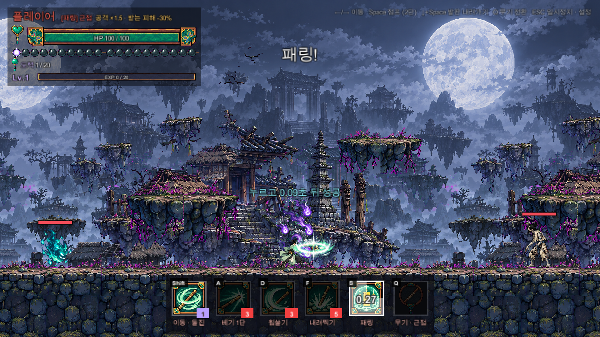
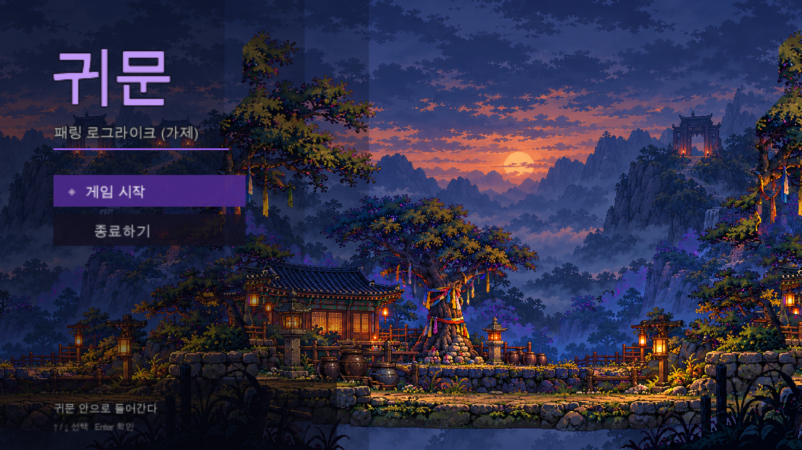
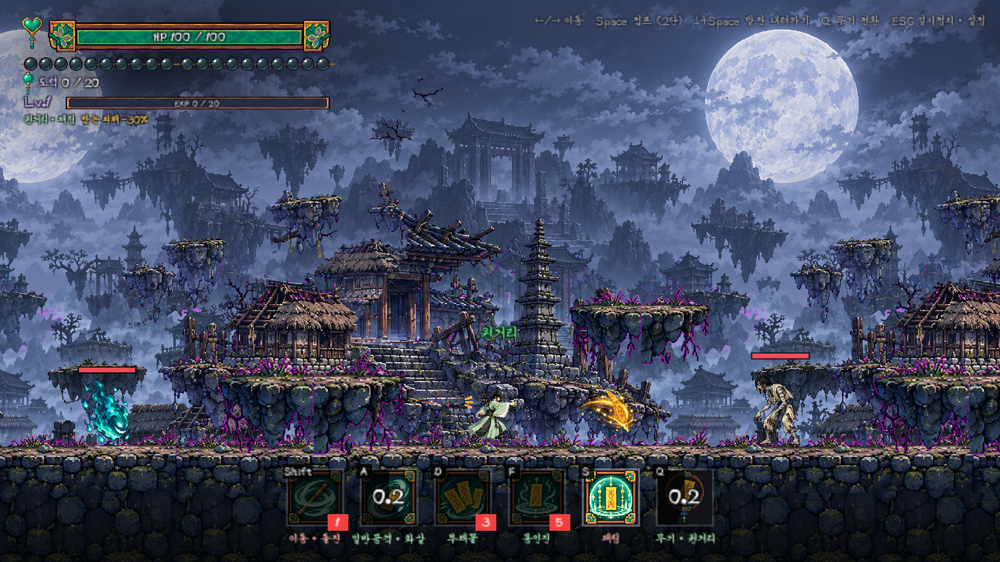
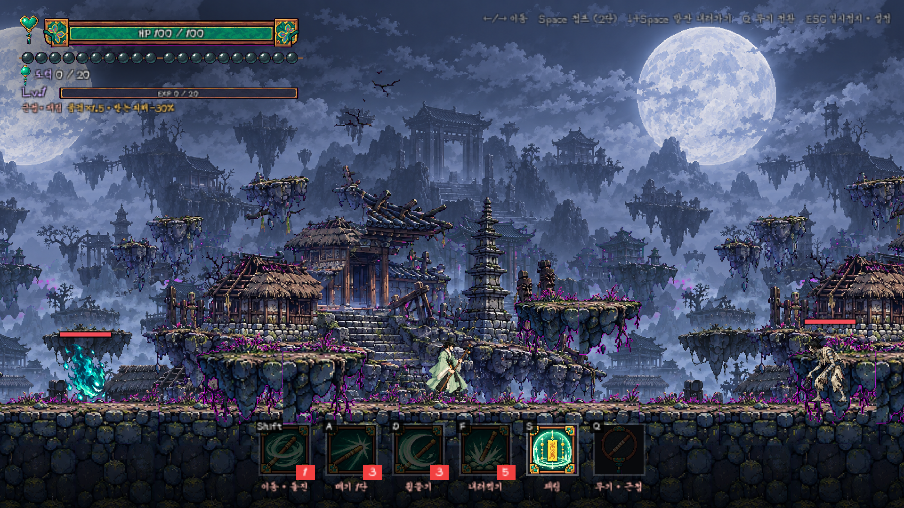

# 귀문 (가제) — 패링 로그라이크

> **적의 공격을 타이밍 맞춰 막아내는(패링) 것이 모든 반격과 성장의 출발점인 2D 횡스크롤 액션 로그라이크.**
> 떠돌이 퇴마사가 열린 귀문(저승으로 통하는 문) 안으로 들어가 가장 깊은 곳의 문을 닫는다. Q 하나로 봉(근접)과 부적(원거리)을 바꿔 들며 싸운다.

졸업 프로젝트 · Unity 6 (6000.6.0f1) · 2D · C#



---

## 한눈에 보기

| 항목 | 내용 |
|---|---|
| 장르 | 2D 횡스크롤 액션 · 로그라이크 (패링 중심) |
| 플레이어 | 퇴마사 한 명. **Q로 봉(근접) ↔ 부적(원거리) 전환**, 무기에 따라 일반공격·반격·스킬창이 바뀜 |
| 핵심 규칙 | 타이밍 맞춰 막으면(패링) 그 자리에서 반격이 나가고 **도력**이 찬다 |
| 성장 | 경험치·레벨은 쌓이지만 지금은 보상이 없다 (증강은 폐지, 요기·스킬 트리는 예정) |
| 적 | 창귀(근접, 예비 모션 뒤 베기) · 도깨비불(원거리 불덩이), 마릿수는 설정으로 조절 |
| 상태 | 프로토타입 — 규칙과 손맛 검증 중 (수치는 모두 가안) |



## 핵심 재미

- **막으면 곧 공격이다**: 패링에 성공하면 같은 자리에서 반격이 나간다. 입력 직후 0.08초 안에 막으면 **퍼펙트 패링** 연출(히트스탑·화면 어둡게·줌·집중선)이 붙는다.
- **연속 패링**: 한 번 막아도 판정 창이 끝까지 유지돼 같은 창 안에 겹쳐 오는 공격도 전부 막힌다. 막은 직후 다시 누르면 창이 새로 열린다. 앞뒤 **양방향** 모두 막는다.
- **무기 전환(Q)**: 쿨타임 0.5초, 도력 소모 없음. 스킬창도 같이 바뀐다.
- **보이는 그림 = 판정 범위**: 캐릭터·몬스터·공격 이펙트의 그림은 판정 박스 위에 판정 크기에 맞춰 그려진다.
- **연습 도구가 내장**: F1 튜닝 패널로 판정·타격감·몬스터 수치를 게임 중 바로 바꾸고, 연습 스위치(무적·무한 도력 등)로 한 가지씩 연습한다.

## 무기

| | ⚔️ 봉 (근접) | 📜 부적 (원거리) |
|---|---|---|
| 일반공격 (A) | 봉 베기 · 데미지 15 · 쿨 0.35초 · 몸이 봉을 따라 살짝 내딛음 | 직진 부적 화살 · 데미지 12 · 쿨 0.45초 |
| 패링 반격 | 근접 박스 (사거리 1.8, 공격력 ×1.5) | 목표를 따라가는 부적 (×1.0) |
| 스킬창 색 | 붉은색 | 초록색 |
| 스킬 D (도력 3 · 쿨 3초) | **휩쓸기** · 앞쪽 넓은 박스(4.0×2.2)를 쓸어 30 데미지 + 기절 0.5초 | **부채꼴** · 부적 5장을 48° 부채꼴로 던짐, 장당 10 |
| 스킬 F (도력 5 · 쿨 6초) | **내려찍기** · 공중에서 내리꽂아 앞쪽 바닥 충격파, 45 데미지 + 기절 1.2초 | **봉인진** · 앞쪽 바닥에 진을 3.5초 깔아 안의 적을 계속 기절시키고 0.7초마다 8 데미지 |
| 공통 | 패링(S) · 대시(Shift, 무적·도력 소모 없음, 연속 2회) · 받는 피해 -30% · 연속/양방향 패링 | 〃 |



## 조작

| 키 | 동작 |
|---|---|
| ← / → | 이동 |
| Space | 점프 (2단, 누르는 시간과 무관한 고정 높이) |
| ↓ + Space | 얇은 발판 아래로 내려가기 (발판은 아래에서 위로는 통과) |
| S | 방어 (패링) — 막은 직후 다시 누르면 판정 창 갱신 |
| A | 일반공격 (무기에 따라 봉 베기 / 부적 발사). 패링 중에도 누르면 같이 나가고, 한 번 막은 직후엔 바로 반격 이어치기 가능 |
| D | 스킬 1 — 봉 휩쓸기 / 부적 부채꼴 (도력 3) |
| F | 스킬 2 — 봉 내려찍기 / 부적 봉인진 (도력 5) |
| Q | 무기 전환 (근접 ↔ 원거리) |
| Shift | 이동 스킬: 돌진 (대시 중 무적, 도력 소모 없음, **연속 2번** — 쿨타임 1초마다 1회분씩 충전) |
| F1 | 튜닝 패널 (판정·타격감·몬스터·연습 스위치) |
| E | 상호작용 (사당의 포탈 · NPC 만신) |
| ESC | 일시정지 — 화면에서 계속(ESC) · 다시 시작(R) · **사당으로(H)** · **시작 화면(M)** (마우스 클릭도 된다). 게임오버 화면에서도 R / H / M. 사당에서는 "사당으로"가 없다 |

## 게임 규칙 요약

- **패링**: 누른 뒤 0.3초 동안 판정 창이 열린다. 닿으면 공격이 부서지고 데미지 없음, 도력 충전(일반 +1 / 강공격 +3), 즉시 반격. 아무것도 못 막고 창이 끝나면 헛스윙(쿨타임 1초). 막은 적이 있으면 헛스윙이 아니다.
- **퍼펙트 패링**: 입력 후 0.08초 안에 닿으면 연출만 강해진다(효과·도력은 동일). 패링 성공 시 접점의 불꽃과 함께 플레이어 몸 주변에 요기 흡수 이펙트가 겹쳐 나온다.
- **도력**(구 게이지): 패링 성공으로만 찬다(최대 20). 화면에는 실에 꿴 구슬(염주) 20개로 보이고, 찬 구슬은 숨 쉬듯 빛난다(앞 10개 옥빛, 뒤 10개 귀문 보라빛). 도력은 D·F 스킬이 쓴다(D 3 · F 5). 일반공격·돌진은 도력 없이 쿨타임만 있다(기본 설정 `attackSkillFree`·`moveSkillFree`, 끄면 일반공격 3·돌진 1).
- **몬스터**
  - 근접: 예비 모션(일반 0.65초 / 강공격 1.2초 — 곧 반응시간) 뒤 몸 앞에서 한 번에 벤다.
  - 원거리: 사정거리 안이면 그 자리에서 쏘고, 벗어나면 다가온다.
  - 피격 경직 0.15초. F1 몬스터 탭에서 종류별 마릿수 1~10 조절.
- **증강은 폐지됐다** (2026-10-13). 레벨업은 "레벨 업!" 알림만 나오고 게임은 멈추지 않는다. 성장 보상(스킬 트리)은 아직 정하지 않았다.

## 사당 (대기 씬)

시작 화면에서 **게임 시작**을 누르면 먼저 사당(`Hub.unity`)에 선다. 적이 없는 대기 공간이다.

- **오른쪽 끝 포탈**(귀문 소용돌이): 가까이 가서 **E** → 플레이(귀문 안) 씬으로 넘어간다.
- **NPC 만신**: **E**로 말을 걸면 스킬 트리 창이 열린다. 지금은 창의 틀만 있고 스킬 노드는 아직 없다 (E · ESC로 닫기, 열려 있는 동안 게임은 멈춘다).
- **씬을 넘나들어도 이어지는 것**: 체력 · 레벨/경험치 · 도력 · 든 무기. 사당 ↔ 플레이 씬 어느 쪽으로 가든 그대로이고, **사당에 들어오면 체력이 자동으로 가득 찬다** (쓰러진 채여도 마찬가지, 도력·레벨·무기는 그대로). **다시 시작(R)·시작 화면으로 나가기·새로 게임 시작**은 처음 상태로 비운다 (쿨타임은 이어지지 않는다).
- 플레이 씬에서는 일시정지(ESC)·게임오버 화면의 **사당으로 (H)** 버튼으로 돌아올 수 있다.
- 상호작용은 플레이어 몸이 대상의 트리거 박스와 겹쳐야 되고, 화면 아래쪽에 `[E] …` 안내가 뜬다.

## 아트 · 사운드

- **귀문 콘셉트 그림 적용** (이펙트 14종 중 12종 연결, 남은 건 귀문 소용돌이뿐): 플레이어(퇴마사 — 갓·옥색 도포)는 무기별(봉 / 부적)로 대기·달리기·패링·반격·일반공격 애니메이션이 따로 있고, 무기를 바꿀 때 교체 동작이 나온다. 적은 **창귀**(근접)와 **도깨비불**(원거리, 청록·빨강 불덩이)이며, 공격·패링·타격·소멸 이펙트가 붙는다. 컬러 도트, 1유닛 = 90px, 판정 네모 위에 그림을 겹쳐 그린다.
- **배경**: 사당·1구간·2구간(황천길)·3구간(저승 문턱) 4곳의 먼·중간·가까운 3겹 배경이 시차 스크롤로 흐른다. F1 → 연습 탭의 "배경 구간 바꾸기"로 바꿀 수 있다 (보스방 배경은 보류).
- 아직 게임에 없는 요괴(두억시니·장산범·어둑시니·불가살이)·스승 만신·보스방 배경·UI 그림은 `ArtSource/gwimun/안내.md`에 정리돼 있고 **보류** 상태다.
- 효과음은 합성음 + 패링 성공음 wav 2개이고, 음악은 없다.
- 에셋을 공개 배포하기 전에 라이선스를 확인할 것.



## 실행

1. **Unity 6000.6.0f1**로 이 폴더를 연다.
2. 메뉴 **Tools → ParryRL → 프로토타입 씬 생성** (씬·프리팹·그림 에셋 묶음을 코드로 만든다. 씬은 생성물이라 직접 편집하지 않는다).
3. `Assets/Scenes/Start.unity`(시작 화면 — 게임 시작 / 종료하기)를 열고 Play. 게임 씬만 바로 보려면 `Assets/Scenes/Prototype.unity`를 연다. 빌드 설정에는 Start(0) → Hub(1, 사당) → Prototype(2, 플레이) 순서로 들어 있다.

### 런처로 실행 (Unity 에디터 없이 게임만)

`Tools/launcher/`의 런처를 더블클릭하면 게임이 시작 화면부터 뜬다. 빌드(`Builds/`)가 없으면 Unity로 먼저 빌드하고(처음 한 번, 1~몇 분) 실행한다.

| 환경 | 파일 | 비고 |
|---|---|---|
| macOS | `Tools/launcher/귀문_실행.command` | 터미널에서 `--rebuild`를 붙이면 다시 빌드 |
| Windows | `Tools/launcher/귀문_실행.bat` | Unity Hub의 *Windows Build Support (Mono)* 모듈 필요. 다시 빌드는 `.ps1 -Rebuild` |

- **바탕화면에서 바로 실행**: `Tools/launcher/바탕화면에_설치.command`(macOS)를 한 번 실행하면 바탕화면에 `귀문.app` 바로가기가 생긴다 — 더블클릭하면 바로 실행되고, 프로젝트가 마지막 빌드보다 새로울 때만 터미널 창에서 자동으로 다시 빌드한 뒤 최신 상태로 실행한다(Unity 에디터는 닫아 둘 것). **프로젝트 폴더를 데스크탑·문서·다운로드 안에 두면** macOS 개인정보 보호가 바로가기 앱의 검사를 막아 항상 터미널을 거친다 — 홈 폴더 바로 아래(`~/ParryRoguelike-main`) 같은 곳에 둘 것. 다른 사람에게 줄 때는 `--copy`로 빌드 통째로 복사(Unity·프로젝트 없이 실행, 자동 갱신 없음). Windows는 `바탕화면에_설치.bat`이 바탕화면에 `귀문.lnk` 바로가기를 만든다 (빌드 폴더를 지우면 끊김).
- Unity가 이 프로젝트를 열고 있으면 배치 빌드가 잠금으로 실패한다 → 에디터를 닫거나, 에디터 메뉴 **Tools → ParryRL → 게임 빌드 (macOS / Windows)** 를 쓴다 (결과: `Builds/Mac/귀문.app`, `Builds/Windows/귀문.exe`).
- Unity 위치가 다르면 `UNITY_PATH` 환경변수에 Unity 실행 파일 경로를 넣는다. 빌드는 `.gitignore`의 `Builds/`라 저장소에 올라가지 않는다.

### 배포하기 (다른 사람에게 게임 주기)

저장소에는 소스만 올라가고 빌드(`Builds/`)는 올라가지 않는다. 플레이할 사람에게는 **빌드 결과물**을 따로 전달한다.

**1. 빌드 만들기**

| 대상 | 방법 | 결과 |
|---|---|---|
| macOS | `Tools/launcher/바탕화면에_설치.command --copy` 또는 에디터 메뉴 **Tools → ParryRL → 게임 빌드 (macOS)** | `Builds/Mac/귀문.app` (약 177MB) |
| Windows | Windows PC에서 `Tools\launcher\귀문_실행.bat`, 또는 에디터 메뉴 **게임 빌드 (Windows)** (*Windows Build Support (Mono)* 모듈 필요) | `Builds/Windows/` 폴더 전체 |

- 빌드는 이 PC의 Unity에서 만든 것이라 **macOS 빌드는 Windows에서, Windows 빌드는 Mac에서 만들 수 없다**(모듈이 있으면 Mac에서 Windows 빌드는 가능하지만 이 PC에는 모듈이 없어 확인하지 못했다).
- 빌드 전에 시작 화면 → 게임 씬이 정상 동작하는지(Start 0번 → Prototype 1번) 에디터에서 한 번 돌려 본다.

**2. 압축해서 전달**

- macOS: 터미널에서 `ditto -c -k --keepParent Builds/Mac/귀문.app 귀문_mac.zip` (일반 zip은 앱의 실행 권한이 깨질 수 있어 `ditto`를 쓴다).
- Windows: `Builds/Windows/` 폴더 **통째로** 압축한다. `귀문.exe`만 따로 주면 실행되지 않는다(`귀문_Data` 폴더, `UnityPlayer.dll` 등이 같이 있어야 한다).
- 전달 방법: Google Drive 같은 공유 링크, 또는 GitHub **Releases**(저장소 → Releases → 새 릴리스에 zip 첨부), 또는 itch.io 업로드.

**3. 받은 사람이 실행할 때**

- macOS: 서명하지 않은 앱이라 처음에 "확인되지 않은 개발자" 경고가 뜬다. 앱을 **우클릭 → 열기**로 한 번 열거나, 터미널에서 `xattr -cr 귀문.app` 후 실행한다. Apple Silicon(M1 이상) 기준으로 빌드했다.
- Windows: SmartScreen 경고가 뜨면 **추가 정보 → 실행**.
- 조작과 규칙은 위 "조작" 표 / 인게임 일시정지(ESC) 메뉴를 보면 된다.

**4. 정식으로 퍼뜨리기 전에 확인할 것**

- **에셋 라이선스**: 그림·효과음의 출처와 재배포 조건을 확인한다(저장소가 공개 상태다).
- 경고 없이 실행되게 하려면 macOS는 Apple Developer 계정(연 약 $99)으로 서명·공증, Windows는 코드서명 인증서가 필요하다. 졸업 작품 시연·공유 정도는 위 경고 우회 방법으로 충분하다.
- **Windows 빌드와 런처는 아직 실제 PC에서 확인하지 못했다.** 배포 전에 Windows 환경에서 한 번 실행해 볼 것.
- 개발용 도구(F1 튜닝 패널, 연습 스위치)가 빌드에도 포함된다. 시연용으로 숨기려면 별도 작업이 필요하다.

### 테스트

PlayMode 테스트 89개(판정·도력·레벨·몬스터·튜닝·그림 연동·무기 전환)와 화면 캡처(`Captures/`)가 있다.

```powershell
# Windows (씬 생성 + 전체 테스트 + 캡처)
powershell -ExecutionPolicy Bypass -File Tools\run_tests.ps1
```

```bash
# macOS — 에디터를 닫은 상태에서 직접 실행
UNITY=/Applications/Unity/Hub/Editor/6000.6.0f1/Unity.app/Contents/MacOS/Unity
$UNITY -batchmode -nographics -quit -projectPath . -executeMethod ParryRL.EditorTools.PrototypeSceneBuilder.Build
$UNITY -batchmode -projectPath . -runTests -testPlatform PlayMode -testResults results.xml
```

에디터가 이 프로젝트를 열고 있으면 배치모드가 잠금으로 실패한다. 그땐 `Assets`·`Packages`·`ProjectSettings`를 다른 폴더에 복사해서 그 사본으로 돌린다.

## 폴더 구조

```
Assets/
├── Scripts/            # asmdef ParryRL (네임스페이스 ParryRL)
│   ├── World/          # 사당: Interactable · PlayerInteractor(E) · ShrinePortal · ShrineNpc · NpcArt · ClipPlayer
│   ├── Core/           # GameManager · GameTuning(튜닝·JSON) · CameraRig · Controls · GameEnums
│   ├── Player/         # PlayerMotor(이동·점프·대시·내딛기) · PlayerDefense(패링 판정) · PlayerCombat(무기·반격·스킬)
│   │                   # PlayerParty(체력·피격) · PlayerSprite/CharacterArt(도트 애니메이션) · SkillGauge
│   ├── Combat/         # DamageCalc · EnemyAttack · MeleeStrike · PlayerProjectile · HitFeel · SuccessEffects
│   │                   # Fx · FxClip/AttackFxArt(공격 이펙트 그림) · Sfx(합성음) · WorldBar
│   ├── Enemy/          # EnemyController · EnemySpawner · EnemySprite/EnemyArt · EnemyCorpse
│   ├── Progression/    # PlayerLevel (경험치·레벨)
│   ├── UI/             # StartMenu(시작 화면) · SkillTreePanel(스킬 트리 창 틀) · Hud · SkillBar · TuningPanel(F1) · UiKit
│   └── Editor/         # PrototypeSceneBuilder (시작·사당·게임 씬·프리팹·에셋 묶음 생성) · GameBuilder (실행 파일 빌드)
├── Tests/PlayMode/     # 판정·몬스터·튜닝·그림·시작 화면·캡처 테스트
├── Art/                # Characters/Hero · Enemies/(Changgwi, Dokkaebibul) · Fx/ (도트 프레임) · Square.png
├── Audio/              # 패링 성공음
└── Scenes/ Prefabs/    # 생성물 (Start.unity · Hub.unity · Prototype.unity)
ArtSource/              # 그림 원본 시트 · gwimun/안내.md(귀문 에셋 안내)
Tools/                  # launcher/(런처) · run_tests.ps1 · sprites/(프레임 자르기)
Tuning/tuning.json      # F1 패널로 바꾼 수치 (팀 공유)
Captures/               # 테스트가 찍는 화면 캡처
```

## 개발 방식 메모

- 모든 판정은 **실제 콜라이더 겹침**이다 (거리 계산 판정 금지). 연출은 `unscaled time`이라 히트스탑 중에도 재생된다.
- 플레이어 딜 계산은 `DamageCalc` 한 곳(기본 × 캐릭터 배율)에서만 한다.
- 플레이 감각 수치는 `GameTuning`(F1 패널)에 둔다.

## 개발 이력 (주요 변경)

1. 별도 패링 프로토타입(연출·효과음·퍼펙트 방어)을 합침
2. 전투 개편: 일반공격 도력(구 게이지) 소모 제거·쿨타임 조정, 원거리 몬스터 AI, 몬스터 수 설정, 얇은 발판·고정 높이 점프
3. 그림 적용: 플레이어·근접 몬스터 도트 애니메이션, 공격 이펙트, 베기 내딛기
4. **궁수·스왑·회피 시스템 폐기** — 플레이어 단독으로 정리, 증강 12종 → 6종
5. 패링 개선: 양방향·연속·겹침 패링, 근접 몬스터 예비 모션 연장
6. **무기 전환(Q)**: 근접 ↔ 원거리, 스킬창 연동
7. **귀문 콘셉트 적용**: 퇴마사·창귀·도깨비불 도트 애니메이션, 공격 이펙트, 구간별 배경, 증강 삭제
8. 대시 개편(도력 소모 없음·연속 2회), 시작 화면·일시정지에서 시작 화면으로, 런처와 바탕화면 앱
9. 패링 직후 공격 허용, 패링 성공 이펙트(요기 흡수·둥근 섬광/고리/불꽃) 개선, 게이지 → **도력** 개명과 구슬 UI

## 문서

- [`기획서.md`](기획서.md): 게임 규칙·수치 기준 문서 (⚠️ 궁수·스왑 폐기 전 내용이 본문에 남아 있다 — 맨 위 경고 참고)
- [`CLAUDE.md`](CLAUDE.md): 개발 규칙·진행 상황·결정 사항
