# 변경 기록 (스크린샷) — 스킬 추가 이후 (2026-10-14 ~ 10-16)

화면이 바뀐 작업을 **전 → 후 스크린샷**으로 남긴다. 사진은 테스트(`CaptureTests`)가 자동으로 찍는 화면(`Captures/*.png`, 1920×1080)을 `docs/screenshots/`에 1280×720 JPG로 줄여 둔 것이고, **"전" 사진은 그때 커밋에 들어 있던 캡처 파일 그대로**다(일부는 그 시점보다 오래된 화면일 수 있다). 화면에 안 보이는 변경(씬 이동 규칙·런처 등)은 글로만 적었다.

| # | 변경 | 커밋 |
|---|---|---|
| 1 | 스킬 D / F 추가 | `b44ea8d` 스킬 추가 |
| 2 | 패링 성공 연출 개선 | `cea2420` 패링 이펙트 개선 · `347ea6d` 패링 이펙트 수정 |
| 3 | 게이지 → 도력, 구슬 UI | `03bb42f` 게이지 시스템 도력으로 명칭 및 ui개선 |
| 4 | 사당 씬과 포탈 | `5a81a48` 사당 씬 제작 및 포탈 구현 · `a606308` 포탈 수정 |
| 5 | NPC 만신과 스킬 트리 창(틀) | `5a81a48` |
| 6 | 플레이 씬에서 사당으로 돌아오기 | `5a81a48` |
| 7 | 씬 이동 시 캐릭터 상태 유지 + 사당 자동 회복 | `a976518` 씬 이동시 캐릭터 상태 유지 |
| 8 | 체력바·아이콘 UI 에셋 적용 | `47a28ee` 체력바 및 아이콘 UI 에셋 적용 |
| 9 | 런처 · 해상도 · 빌드 오류 수정 | `ee52f6f` `4a8bead` `2c2f999` `35f2244` |
| 10 | 바닥·벽·발판 타일 그림 적용 (2026-10-16) | 이 문서가 들어간 커밋 |

---

## 1. 스킬 D / F 추가 — 새 기능

도력 3(D) / 5(F)을 쓰는 스킬 4개. 무기에 따라 내용이 바뀌고, 스킬바가 6칸(Shift · A · D · F · S · Q)이 됐다.

**봉 D — 휩쓸기** (넓은 범위 30 데미지 + 짧은 기절)
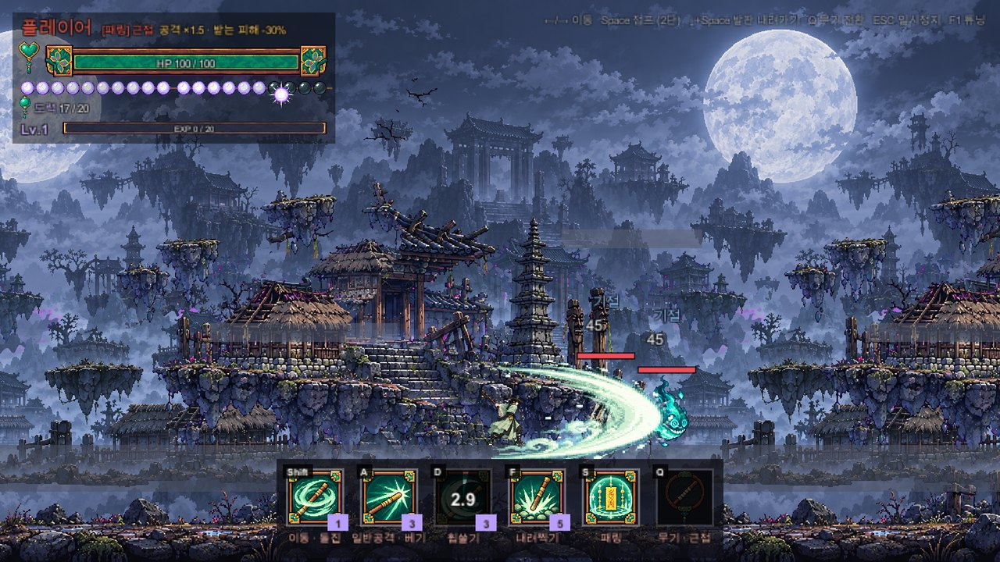

**봉 F — 내려찍기** (바닥 충격파 45 데미지 + 긴 기절)
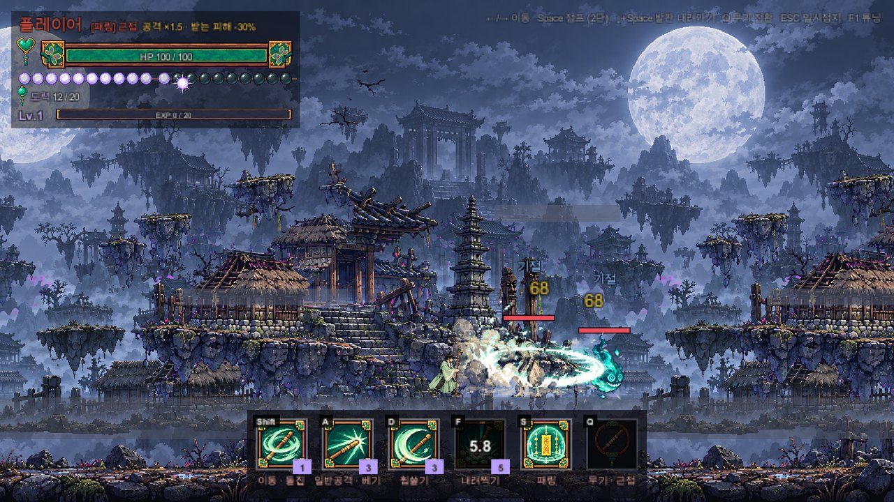

**부적 D — 부채꼴** (부적 5장)
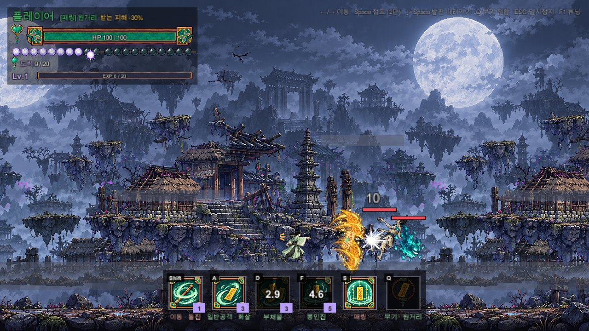

**부적 F — 봉인진** (진 안의 적을 묶고 지속 데미지)
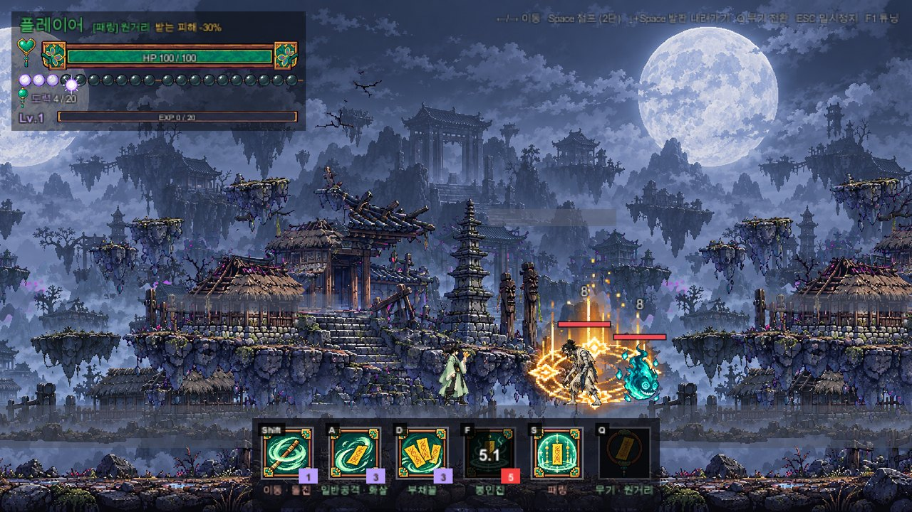

## 2. 패링 성공 연출 개선

| 전 (`4a8bead`): 접점에 둥근 흰 섬광과 고리 | 후 (`347ea6d`~): 패링 그림(금빛 불꽃)이 성공 이펙트 |
|---|---|
| 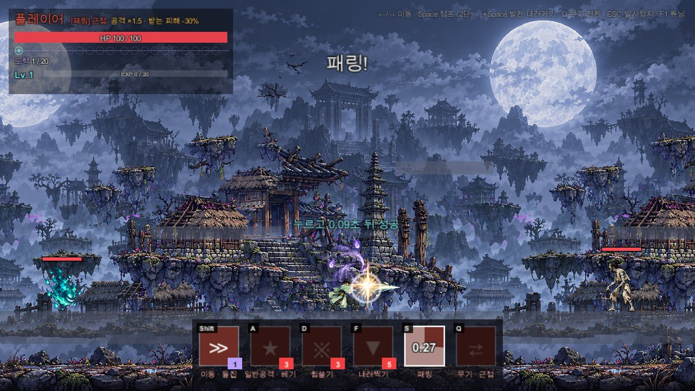 | 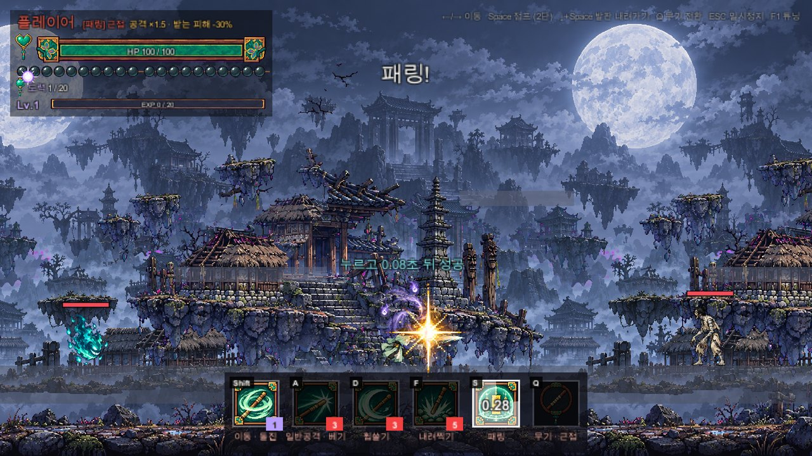 |

- 먼저 접점의 네모 섬광·네모 고리·네모 파편을 둥근 빛/고리/불꽃으로 바꿨고(`cea2420`, 그때는 스크린샷을 안 남겼다), 그다음 둥근 섬광·고리를 없애 패링 그림(봉: 금빛 불꽃 / 부적: 깨지는 부적)이 성공 이펙트를 맡게 했다(`347ea6d`). 위 "전" 사진은 둥근 섬광·고리 단계다.
- 패링 성공 시 플레이어 몸 주변에 요기 흡수 이펙트가 겹쳐 나온다.

## 3. 게이지 → 도력, 구슬 UI

| 전: 게이지 네모 20칸 | 후: 도력 구슬 (코드로 그린 구슬) |
|---|---|
| 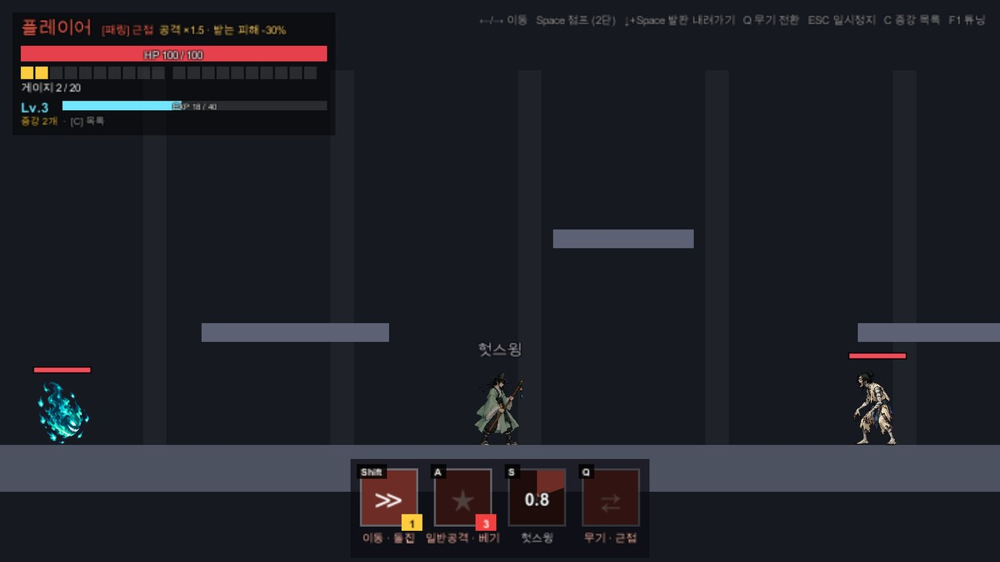 | 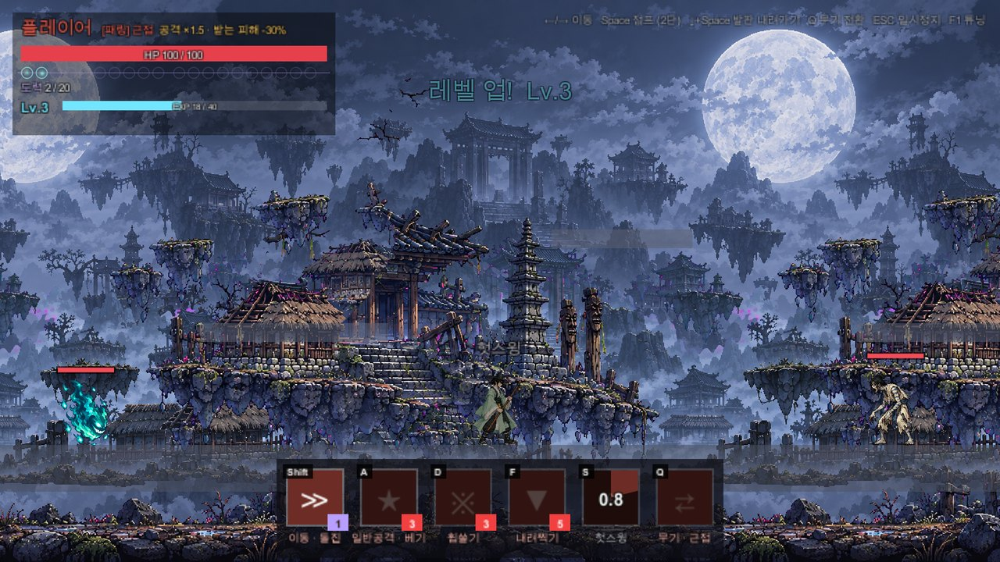 |

- 화면의 "게이지"를 전부 "도력"으로 바꾸고, 네모 칸을 실에 꿴 구슬 20개로 바꿨다(앞 10개 옥빛, 뒤 10개 귀문 보라빛, 찬 구슬은 숨 쉬듯 빛남).
- (왼쪽은 증강 개수 표시가 있던 시절 화면이다. 증강은 그 뒤 삭제됐다.)

## 4. 사당 씬과 포탈 — 새 씬

시작 화면 → **사당** → 플레이 씬. 사당은 적이 없는 대기 공간이고 플레이어는 왼쪽에서 시작한다. 오른쪽 끝 포탈에서 E를 누르면 플레이 씬으로 넘어간다.

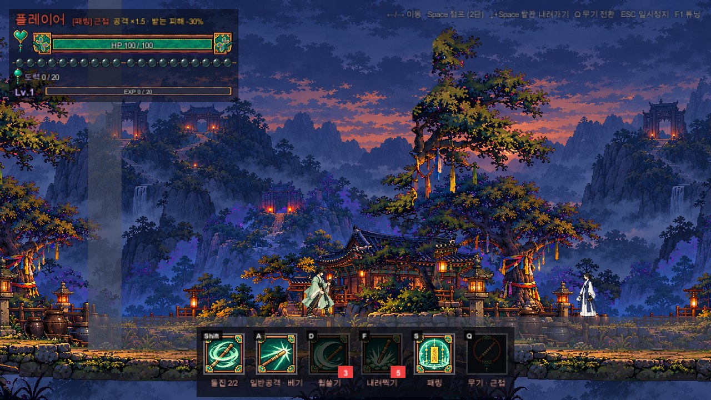

**멀리서 본 포탈** — 문 안쪽에 소용돌이가 일렁이고 빛무리가 은은하다.
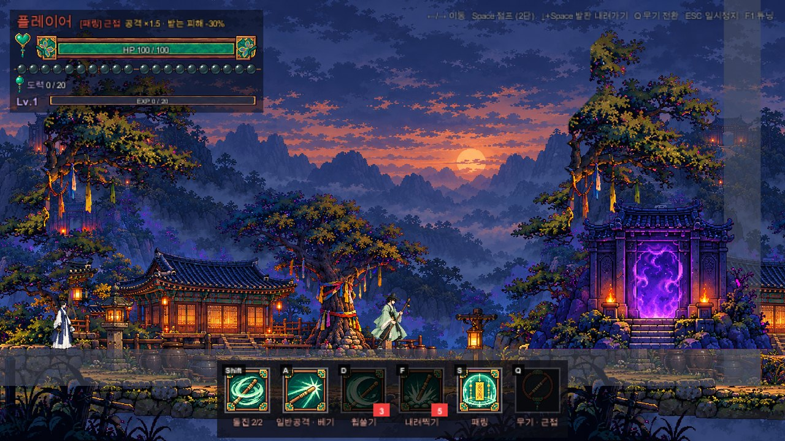

**가까이 가면** 더 밝아지고 `[E] 귀문으로 들어가기` 안내가 뜬다.
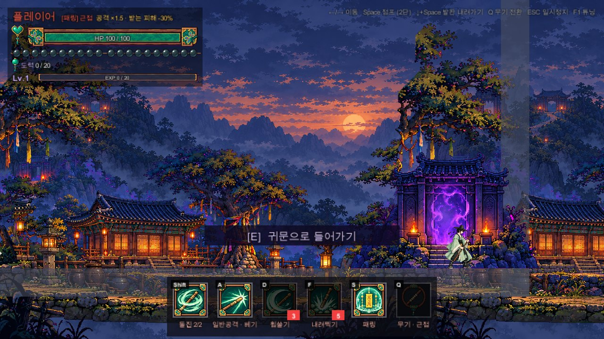

- 문 그림은 에셋 폴더의 사당 소품 시트에서 직접 오렸고(바깥 마젠타만 투명), 문 안쪽 소용돌이는 8장 스트립을 줄마다 물결치게 밀어 16장으로 늘려 썼다.

## 5. NPC 만신과 스킬 트리 창(틀)

**E로 말 걸기** — 만신은 대기 모션으로 서 있고 플레이어 쪽을 바라본다.
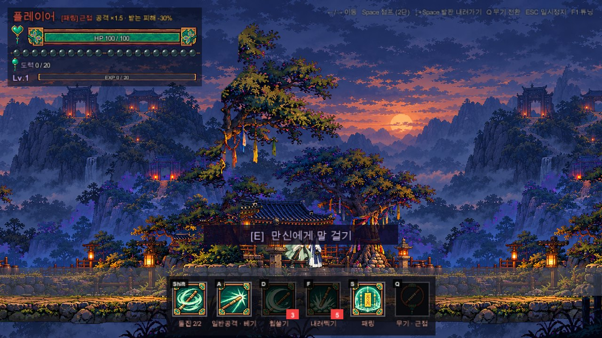

**스킬 트리 창** — 지금은 틀만 있다(스킬 노드·습득은 아직 구현 전). 열려 있는 동안 게임이 멈추고 E·ESC·버튼으로 닫는다.
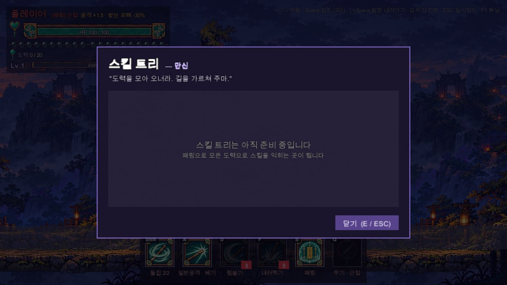

## 6. 플레이 씬에서 사당으로 돌아오기

| 전 (`347ea6d`): 계속 · 다시 시작 · 시작 화면 | 후: 계속 · 다시 시작 · **사당으로(H)** · 시작 화면 |
|---|---|
| 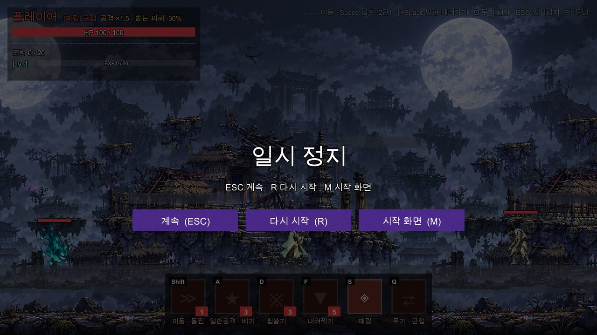 | 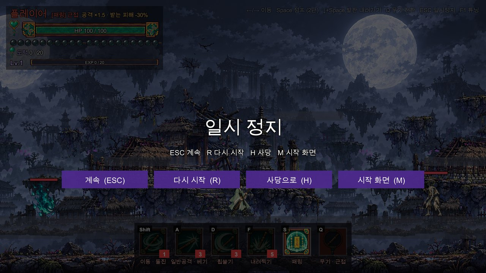 |

- 사망 화면에도 "사당으로" 버튼이 있다. 사당 씬에서는 이 버튼이 없다.

## 7. 씬 이동 시 캐릭터 상태 유지 + 사당 자동 회복 (글로만)

- 사당 ↔ 플레이 씬을 넘나들어도 **체력 · 레벨/경험치 · 도력 · 든 무기**가 이어진다. 사당에 들어오면 체력이 자동으로 가득 찬다(쓰러진 채여도). 다시 시작 · 시작 화면으로 나가기 · 새 게임은 처음 상태로 비운다.

## 8. 체력바·아이콘 UI 에셋 적용

| 전: 도력 구슬(코드) · 네모 체력바 | 후: 귀문 UI 에셋 |
|---|---|
|  | 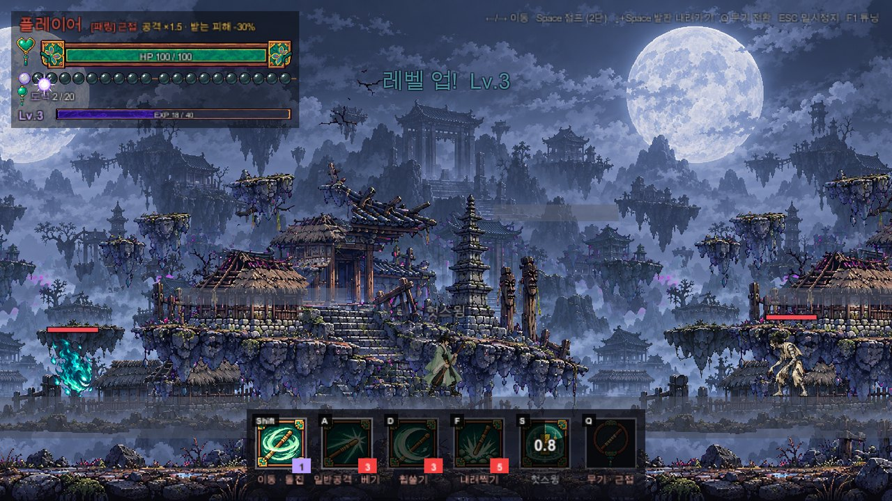 |

**스킬바**

| 전 | 후 |
|---|---|
| 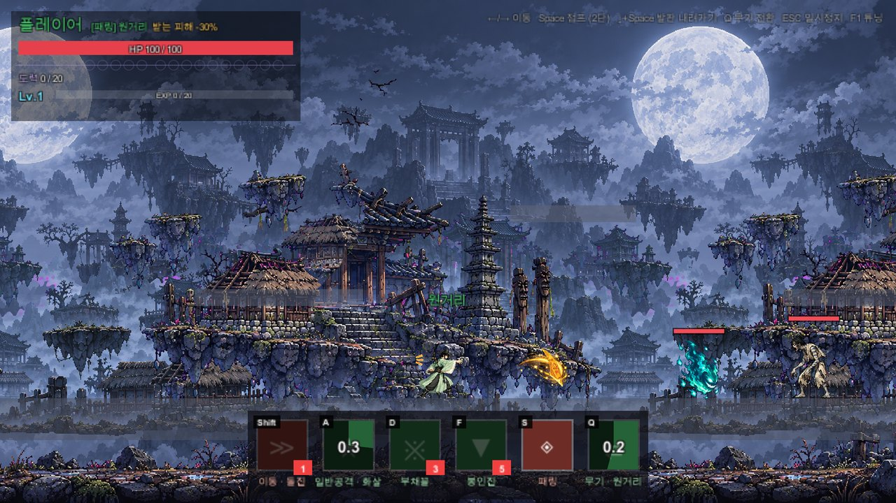 | 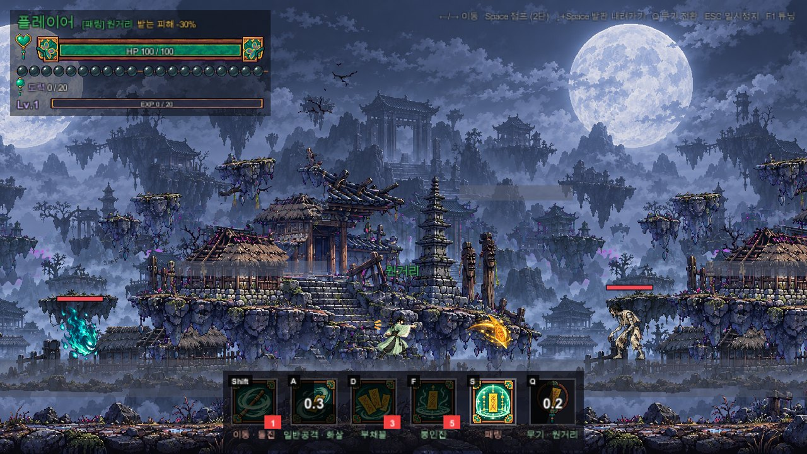 |

- 체력: 하트 아이콘 + 옥 장식 틀 안에 초록 바(빨강은 적 공격 경고 전용). 도력: 빈 구슬 / 찬 구슬 / 방금 찬 반짝 구슬. 경험치: 구리 바 + 보라 채움.
- 스킬바: 글자 아이콘 대신 에셋의 스킬 아이콘(대시 · 일반공격 · D · F · 패링), Q는 든 무기의 메달(봉/부적).

## 9. 런처 · 해상도 · 빌드 오류 수정 (글로만)

- **런처 자동 갱신**: 프로젝트가 빌드보다 새로우면 런처가 다시 빌드한다. 바탕화면 `귀문.app`은 바로가기 앱이며, 프로젝트를 `~/ParryRoguelike-main`으로 옮겨(데스크탑 폴더는 macOS 개인정보 보호가 검사를 막는다) 바뀐 게 없을 땐 터미널 없이 바로 뜬다.
- **빌드된 게임이 바로 죽던 문제**: 시작 화면 스크립트(`MenuCameraPan`)가 다른 이름의 파일에 들어 있어 씬에 임시 번호로 저장 → 에디터는 멀쩡하고 빌드만 죽었다. 파일을 분리하고 씬 파일 무결성 테스트를 추가했다. 빌드 스크립트의 씬 목록에 사당이 빠져 "게임 시작"이 안 넘어가던 문제도 고쳤다.
- **해상도**: 빌드 스크립트가 해상도·전체화면 모드를 1600×900 창으로 덮어쓰던 것을 없앴다. 이제 에디터의 Player Settings 값(`fullscreenMode: 2`, Maximized Window)이 런처 빌드에 그대로 쓰인다.

## 10. 바닥·벽·발판 타일 그림 적용 (2026-10-16)

바닥·벽·발판이 반투명 네모(임시)였던 것을 구간별 타일 그림으로 바꿨다. 판정(콜라이더 네모)은 그대로이고 그림만 위에 깐다 → 보이는 땅 윗면 = 판정 윗면. 네모는 F1 "판정 상자 보기"일 때만 반투명하게 겹쳐 보인다.

| 전: 반투명 네모 바닥 | 후: 1구간 |
|---|---|
|  | 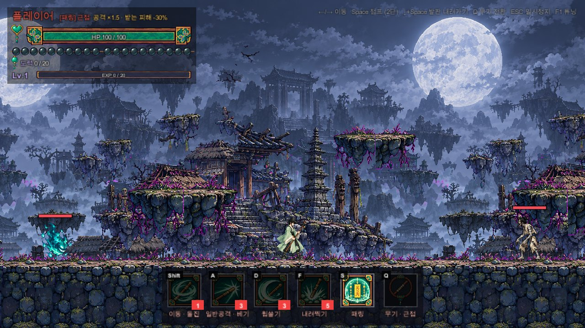 |

**2구간 (황천길)** — 땅 윗면 8종 + 속 채움 8종을 번갈아 깔아 반복이 티 나지 않게 했다.
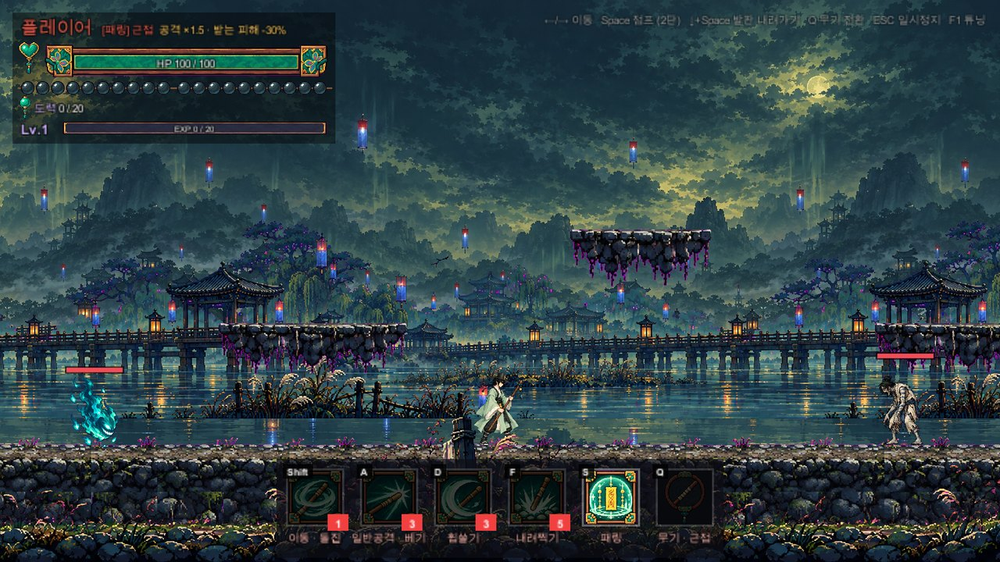

**3구간 (저승 문턱)**
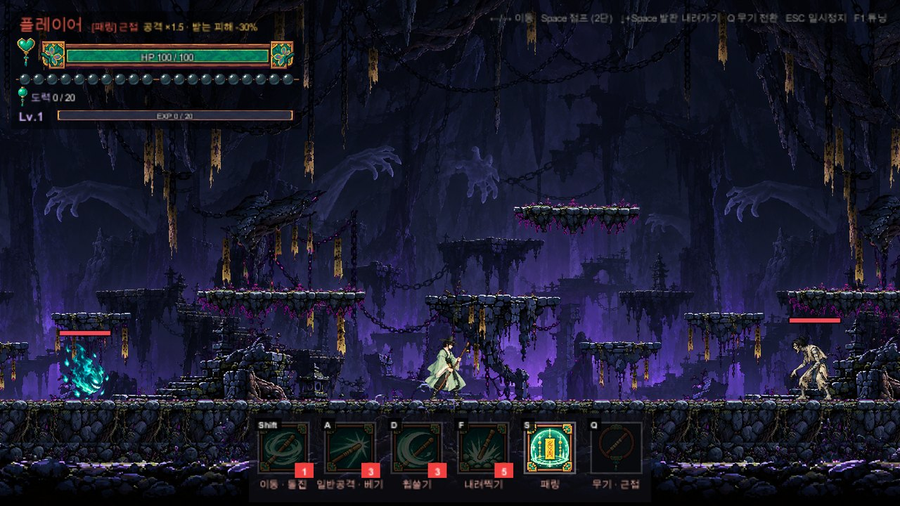

**사당** — 에셋의 "땅 한 줄" 조각 하나를 이어 붙였다 (사당 씬은 구간 0 고정).
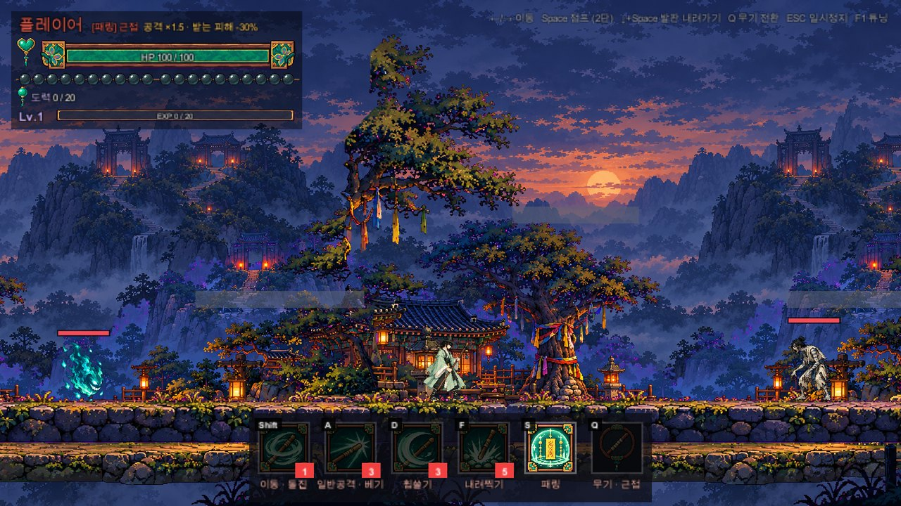
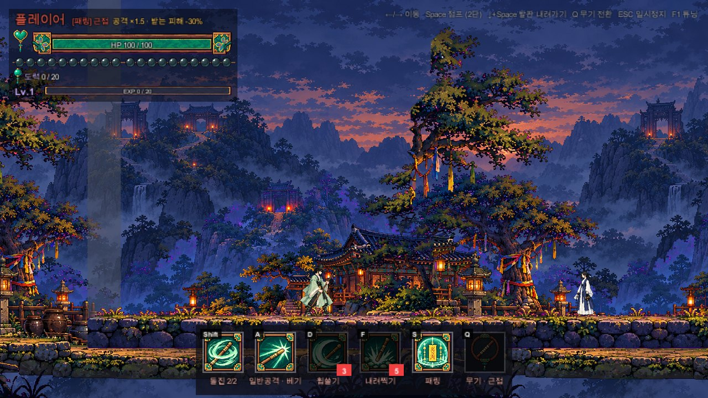

- 새 타일 시트(`floor_tiles_*`)를 에셋 공유 폴더 `원본/bg/<구간>/`에 추가하고, 칸 경계의 보라색 선 때문에 칸을 2px 안쪽으로 잘라 `Assets/Art/Floor/`에 필요한 칸만 오렸다(`Tools/gwimun_sprites/cut_floor.py`).
- 바닥 판정 두께 1유닛 = 윗면 타일 몸통 높이가 되도록 구간별 배율을 정했고, 윗면 아래로는 속 채움 타일을 3.5유닛까지 깔았다. 벽은 속 채움 타일을 벽 안쪽 면에서 바깥으로 쌓았다. 발판은 왼쪽 끝 + 가운데(필요한 만큼) + 오른쪽 끝 조각을 판정 폭에 맞춰 이어 붙인다.
- 사당 구간에는 발판 조각이 없어 발판을 없앴다(플레이 씬에서 사당 배경을 고르면 발판이 사라지고, 다른 구간을 고르면 다시 생긴다).
- 한계: 보스방 타일 시트는 받아 두었지만 보스방이 아직 없어 쓰지 않았다. 발판 조각 이음새에 얇은 선이 살짝 보일 수 있다.

**옆 벽을 화면 밖으로**: 전에는 아레나 양 끝에 반투명(또는 타일) 벽이 화면에 보였다. 벽을 카메라가 멈추는 끝(아레나 반폭 + 1)에 안쪽 면이 닿게 바깥으로 옮겨서, 벽은 보이지 않고 플레이어는 화면 끝에서 막힌다 (플레이 씬 · 사당 모두). 아래는 오른쪽 벽에 몸이 닿은 모습.
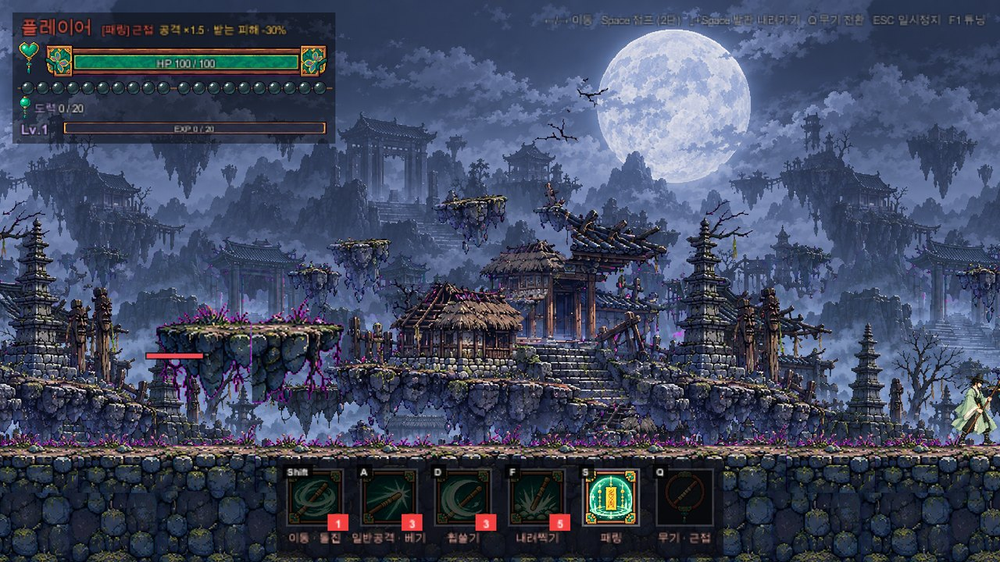

## 11. 도력 구슬 — 반짝이는 구슬 위치 수정 (2026-10-16)

**전** — 방금 찬 구슬(반짝이는 큰 구슬)이 8번째 자리에서 오른쪽으로 밀려 8·9번째 사이에 걸려 보였다. 원인: 구슬 그림의 기준점이 왼쪽 위 모서리라, 1.9배로 키우면 그 모서리를 고정한 채 오른쪽 아래로 커졌다.

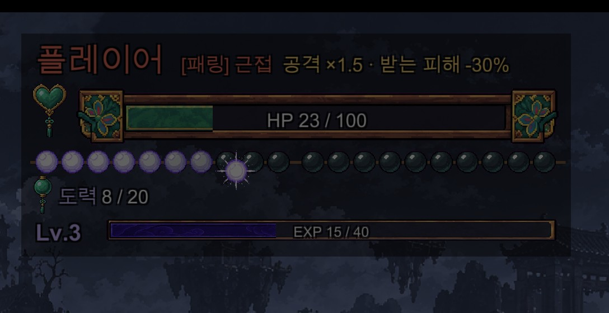

**후** — 기준점을 가운데로 바꾸고 확대를 1.5배로 줄여 8번째 자리에서 제자리 맥동한다 (도력 8/20, 체력 23/100).

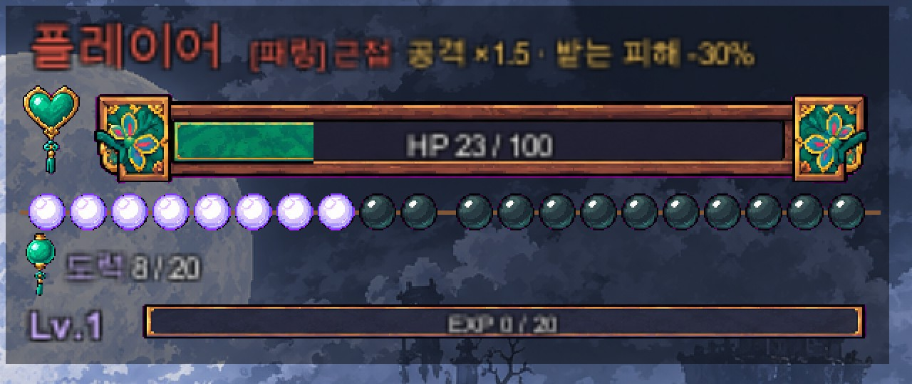

**반짝임은 "막 얻은 순간"에만** — 갖고 있는 구슬과 못 얻은 구슬이 헷갈린다는 지적에 따라, 가장 최근 구슬을 계속 반짝이는 큰 구슬로 두던 것을 바꿨다. 이제 갖고 있는 구슬은 전부 같은 모양이고, 새로 얻은 구슬만 0.6초 동안 반짝였다가 제 크기·모양으로 돌아온다. 아래 위: 막 얻은 순간(테스트가 8개를 한꺼번에 더해서 8개가 모두 반짝) / 아래: 잠시 뒤 (전부 같은 모양, 개수가 한눈에 보인다).

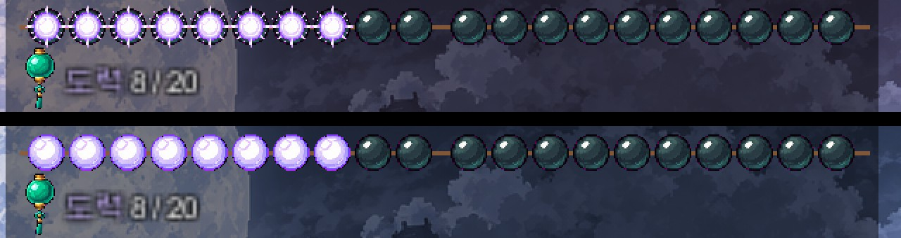

## 12. 근접 몬스터(창귀) "지금 눌러" 느낌표 — 노랑 → 빨강 (2026-10-16)

일반·강공격 모두 같다. 예비 모션이 시작되면 **노란 느낌표**가 톡 튀어나와 둥실거리고(공격이 온다), 베기 직전에 **빨갛게** 바뀌며 한 번 커졌다 가라앉는다(지금 패링!). 빨간 느낌표가 보이면 바로 패링(S)을 누르면 막힌다. 베기가 나가면 느낌표는 서서히 사라진다.

| 노란 느낌표 (공격이 온다) | 빨간 느낌표 (지금 패링!) |
|---|---|
| (왼쪽) | (오른쪽) |

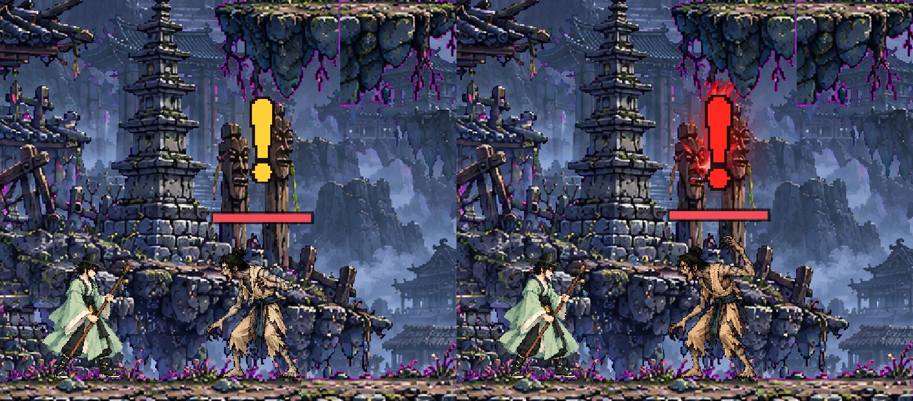

- 그림은 코드로 그린 둥근 느낌표(검은 테두리 + 뒤 빛무리). 색을 노랑↔빨강으로 자연스럽게 바꾸려고 에셋의 번개 모양 느낌표 대신 쓰고, 에셋의 붉은 번개 이펙트(`heavy_warning`)는 빨갛게 바뀌는 순간 뒤에서 한 번 퍼지는 불꽃으로 남겼다.
- 시점은 `EnemyController.pressCueFraction`(0.8): 빨갛게 바뀌는 때 = 베기 `defenseActiveTime × 0.8`초 전. 몸이 커져도 머리 위를 따라가고(체력바 위), 맞아서 끊기면 사라진다.
- 테스트: 노란색으로 시작 → 같은 느낌표가 빨갛게 바뀜(하나뿐) → 빨갛게 보이는 즉시 패링하면 피해 0 → 베기 뒤 사라짐.

## 13. 창귀 공격: 방향·위치 고정 + 대시로 피해도 끊기지 않음 (2026-10-16)

- **방향·위치 고정**: 공격(예비 모션)을 시작하는 순간 방향을 정해 두고, 그 뒤엔 플레이어가 이동·대시로 반대편에 가도 **따라 돌거나 움직이지 않고 그 자리에서 그대로** 벤다. (전에는 예비 모션 중에도 플레이어를 보며 방향이 바뀌고, 베는 순간 플레이어 쪽으로 방향이 다시 정해졌다.) 그래서 옆으로 지나가면 헛스윙이 된다.
- **대시로 피해도 끊기지 않음**: 무적 대시로 베기를 통과하면 전에는 베기가 회색으로 흐려지며 뚝 사라졌다. 이제는 맞지는 않지만(판정만 꺼짐) 베기는 끝까지 뻗는 모습을 그대로 보여준다.

대시 중(무적)인 플레이어(왼쪽, 뒤로 대시)를 지나 베기가 끝까지 뻗는 장면 — 흐려지지 않고 진한 빨강 그대로, 체력은 그대로:

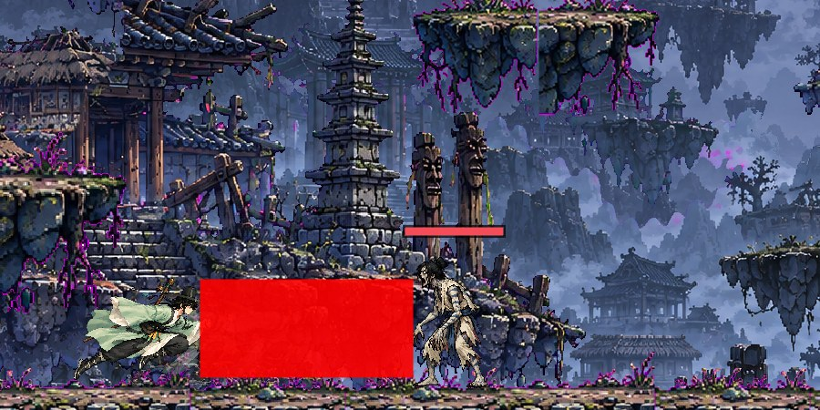

- 테스트: 공격 도중 플레이어가 반대편으로 가도 몬스터 위치·방향이 그대로이고 처음 향한 쪽에서 벤다 / 대시 중 베기를 맞아도(통과) 사라지지 않고 끝까지 뻗고 체력은 그대로 (수정 전 코드로 되돌리면 이 테스트는 실패함을 확인).

## 14. 퇴마사 이펙트 1016 에셋으로 교체 (2026-10-16)

디자인 에셋 기준 폴더를 `귀문_에셋_공유_1016`으로 바꾸고, **지금 게임에 있는 이펙트만** 1016의 같은 역할 그림으로 교체했다. 새 기능(콤보 3타·충전·강화판·궁극기·분신·결계·대시 흔적 등)은 추가하지 않았다. 교체한 것: 봉 베기(A · D 휩쓸기), 근접 반격, 패링 성공(봉), 요기 흡수, 부적 적중, 봉 내려찍기(F), 부적 봉인진(F), 퍼펙트 패링.

**봉 휩쓸기 (D)** — 일반공격 베기와 같은 그림 (콤보 1)
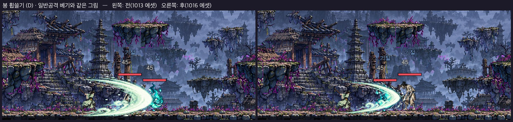

**봉 내려찍기 (F)** — 가시 모양에서 흙·돌이 솟구치는 땅 충격파로
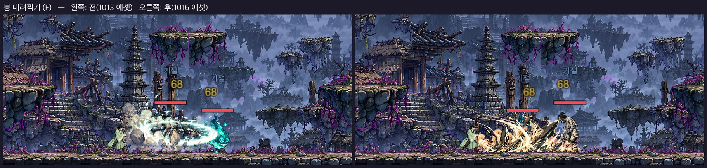

**부적 봉인진 (F)** — 펼쳐지는 장면(시작) → 반복 → 사라지는 장면(끝) 3단계로 재생
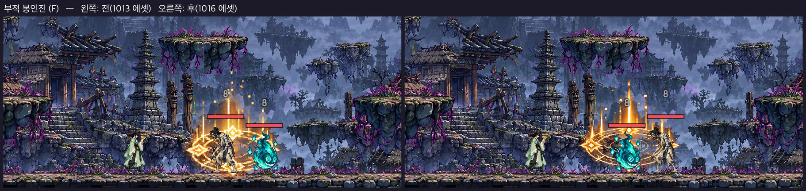

**패링 성공 (봉)** — 불꽃 대신 패링 충격파(둥근 고리)
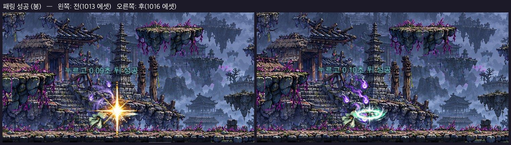

- 교체하지 않은 것: 부적 날아가기·부적 패링 불꽃(1016에 대응 이펙트 없음), 착지 먼지, 요괴 소멸·타격 불꽃·강공격 경고·포탈(몬스터·공용 이펙트).
- 시트의 한 칸이 그림보다 훨씬 커서 그대로 쓰면 판정 박스에 맞출 때 그림이 작아진다 → 클립별로 불투명 영역의 합집합 상자로 잘라 썼다(`Tools/gwimun_sprites/cut_fxhero.py`). a/b로 나뉜 시트는 a 다음 b로 이어 붙였다.
- 판정 박스·수치·쿨타임·조작은 그대로다 (그림만 바뀜).

## 15. 봉 일반공격 단계별 공격 (1 → 2 → 3단) (2026-10-16)

봉(근접)으로 **A를 이어 누르면 1 → 2 → 3단**으로 커진다. 단마다 1016의 콤보 이펙트 1·2·3이 그대로 나온다. 위에서부터 1단 · 2단 · 3단:

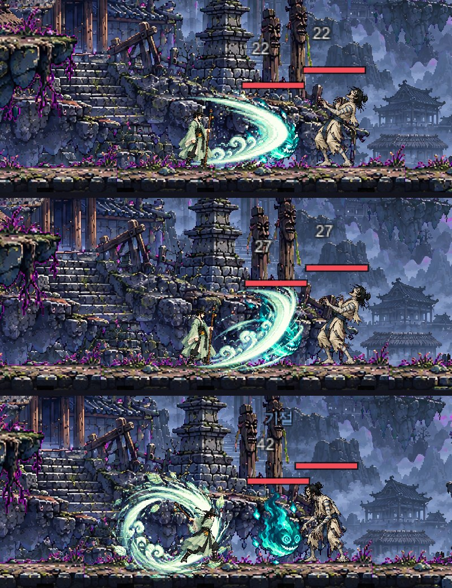

| 단 | 모양 | 판정(박스) | 데미지(기본 → 배율 ×1.5 적용) | 쿨타임 |
|---|---|---|---|---|
| 1 | 초승달 베기 | 앞쪽 2.4×1.6 | 15 → 22 | 0.35초 |
| 2 | 위로 올려 베기 | 앞쪽 2.6×1.9 | 18 → 27 | 0.35초 |
| 3 | 몸을 감싸는 회오리 마무리 | **플레이어가 가운데, 양옆** 3.4×2.2 | 28 → 42 + 기절 0.35초 | 0.6초 |

- 한 단을 치고 쿨타임이 끝난 뒤 0.6초 안에 다음 A를 누르면 이어지고, 놓치면 1단부터 다시. 3단(마무리)을 치면 처음으로 돌아간다. 무기를 바꿔도 1단부터. 부적(원거리)에는 단계가 없다.
- 스킬바 A 칸 이름이 "베기 1단 / 2단 / 3단"으로 바뀌어 다음에 나갈 단을 보여 준다.
- D 휩쓸기는 그대로(1단 그림을 재사용).
- 수치(데미지·박스·기절·쿨타임·이어치기 시간)는 `PlayerCombat` 인스펙터 필드. 모두 임시값.

## 16. 부적 봉인진(F) — 바닥에 깔린 느낌으로 (2026-10-16)

에셋의 봉인진 그림은 **비스듬히 내려다본 둥근 진**(타원이 꽤 둥글다)이라, 옆에서 보는 이 게임에서는 "위에서 보는" 느낌이 났다. 그림을 둘로 나눠서 **진은 세로로 납작하게 눌러 바닥에 깔린 얇은 타원으로**, **빛기둥은 눌리지 않게 그 위로 곧게 솟게** 그렸다. 진의 중심선이 바닥에 닿는다. (그림 파일은 그대로, 코드가 한 장면을 위·아래로 나눠 두 층에 그린다.)

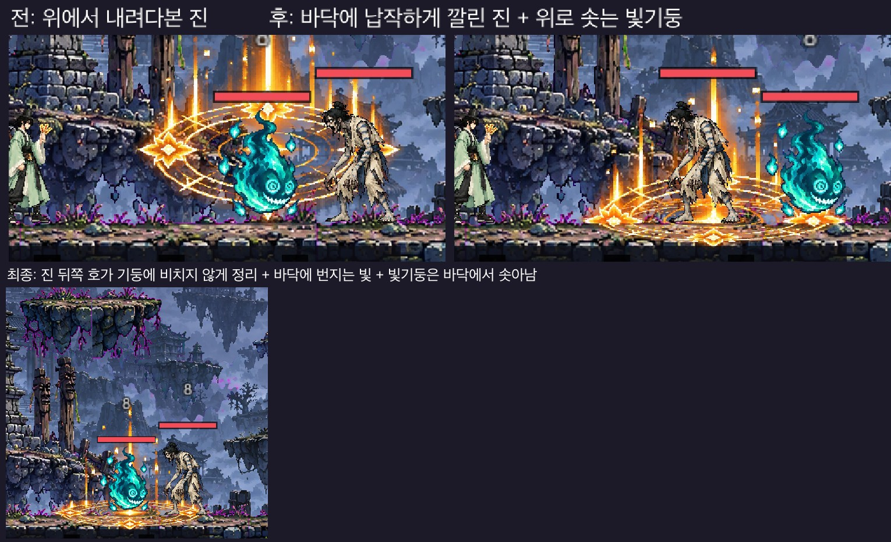

- 진 세로 납작함(`SealZone.RingFlatten` 0.4)·빛기둥 크기(`PillarScale` 1.0)는 상수라 보면서 조절할 수 있다. 판정 박스(3.2×1.6)·지속 시간·데미지는 그대로.

**봉인진 한 번 더 다듬기** — 처음 나눈 방식은 눌리지 않은 **뒤쪽 호**가 빛기둥 사이에 곡선으로 비쳐 부자연스러웠다. 그래서 (1) 진 층은 뒤쪽 호까지 함께 눌러 하나의 납작한 진으로, (2) 빛기둥 층은 맨 위~진 위쪽 가장자리까지만 쓰고 **아래 끝을 부드럽게 흐려** 바닥에서 솟아나게, (3) 진 아래에 **은은한 금빛이 바닥에 번지는** 층(시작·끝에서 서서히 켜지고 꺼짐)을 더했다. 위 사진 맨 아래가 최종 모습.

## 17. 이동하며 공격해도 베기 이펙트가 뒤로 밀리지 않게 (2026-10-16)

**증상**: 근접(봉)으로 달리거나 돌진하며 공격하면, 베기 그림이 공격이 나간 그 자리에 남아 플레이어는 앞으로 가는데 이펙트만 뒤에 처졌다(공격마다 앞으로 살짝 내딛는 `Lunge`에도 같은 일이 생겼다). **원인**: 베기 그림을 월드 좌표의 한 자리에 만들고 끝까지 그 자리에 뒀다.

**수정**: 베기 그림(일반공격 1~3단 · 반격 · D 휩쓸기)이 재생되는 동안 **플레이어를 따라 움직이게** 했다(생길 때의 플레이어와의 거리를 유지). 판정은 공격이 나간 순간 그 자리에서 한 번이라는 규칙은 그대로이고, 그 뒤의 이동에 그림만 따라간다. 땅에 닿는 F 스킬(내려찍기·봉인진)은 바닥에 남는 게 맞아 따라가지 않는다.

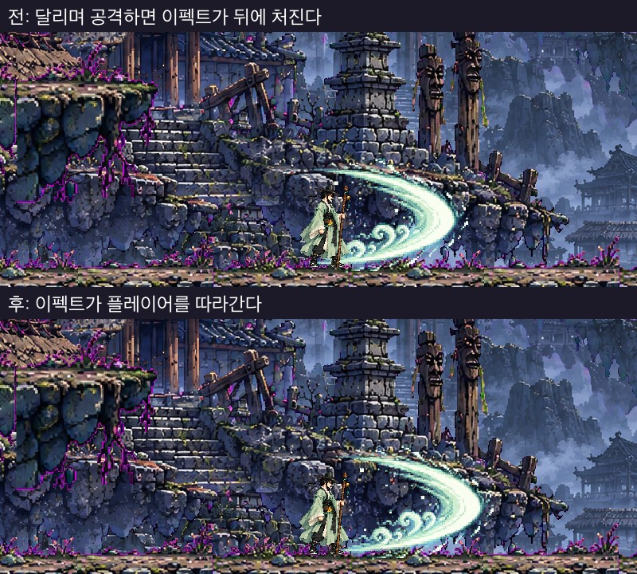

- 위: 전(이펙트가 시작 자리에 남음) / 아래: 후(플레이어 앞에 붙어 따라감). 캡처는 오른쪽으로 달리는 0.17초 동안이라 차이가 크지 않다 — 오래 달릴수록 차이가 커진다.
- 테스트: 공격 직후 플레이어를 앞으로 옮기면 이펙트와의 거리가 유지된다 (수정 전 코드로 되돌리면 실패함을 확인).

## 18. 사당 바닥을 에셋 지형 타일로 (2026-10-16)

**증상**: 사당 바닥이 "땅 한 줄" 조각 하나뿐이라 아래가 비어 배경이 비쳤고, 한 줄 조각을 어둡게 이어 채워 봐도 에셋과 달라 어색했다. **수정**: 에셋 `미리보기/tiles/shrine/`의 지형 타일 세트(1칸 = 90px = 1유닛)를 그대로 썼다 — 윗면은 풀 덮인 `ground_14`, 속은 자갈 흙 `ground_15` + 무늬 변형 4장을 섞어 아래로 채운다(에셋 데모 `shrine_demo.png`와 같은 모습). 바닥 판정은 그대로.

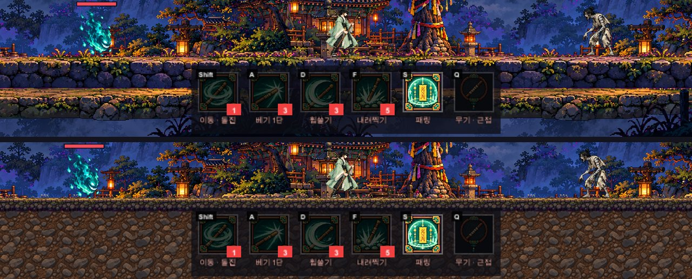

- 위: 전(땅 한 줄만) / 아래: 후(에셋 타일). 테스트 136개 통과.

## 19. 사당 NPC 스킬 트리 — 체력·공격력·자원 스탯 올리기 (2026-10-17)

만신에게 말을 걸면 열리던 "준비 중" 창을 **스탯을 올리는 스킬 트리**로 채웠다. 창·노드 틀·이음 줄은 에셋 `skilltree.png`(두루마리 + 노드 틀 4종 + 점선/빛나는 줄)를 그대로 썼다.

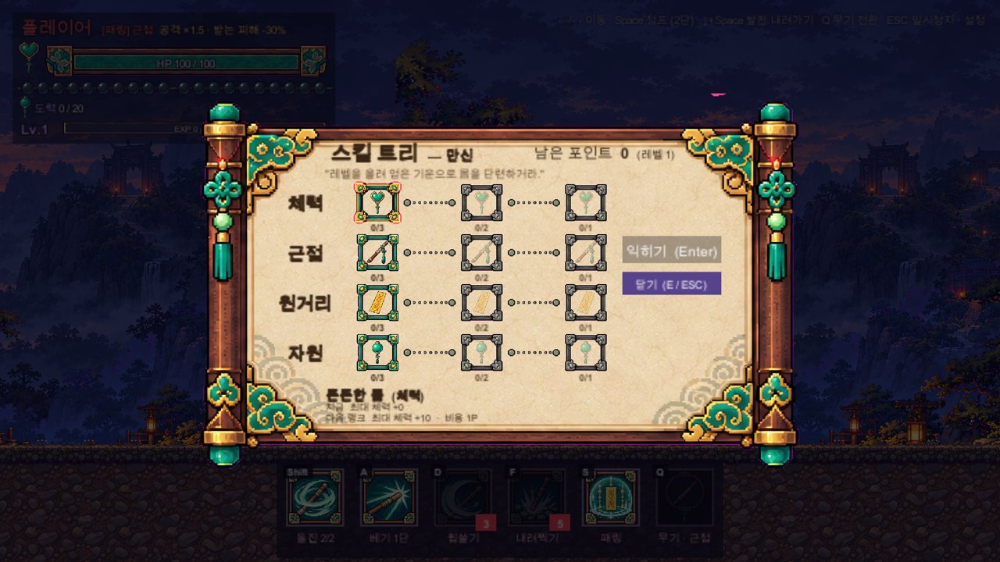
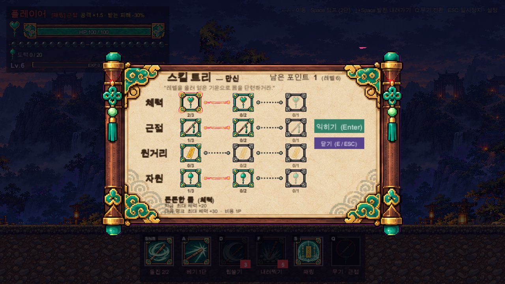

- **세 줄 × 노드 3개**: 체력(최대 체력 +10×3 → +15×2 → +25×1) · 공격력(+5%×3 → +8%×2 → +15%×1) · 자원(경험치 획득 +10%×3 → 패링 성공 도력 +1×2 → 판 시작 도력 +3×1). 앞 노드를 1랭크 이상 익히면 이음 줄이 빛나며 다음 노드가 열린다(잠긴 노드는 회색 틀).
- **포인트 = 레벨업 1회당 1점** (총 포인트 = 레벨 − 1). 임시 규칙이다 — 영혼석 같은 재화가 정해지면 `SkillTreeState`만 바꾸면 된다.
- 조작: 마우스 클릭 · ←/→/↑/↓ 선택 · Enter/Space 익히기 · E/ESC 닫기. 익힌 값은 사당 → 플레이 씬으로 이어지고 새 게임/다시 시작에서 비워진다.
- 노드는 `SkillTreeState.Nodes` 표 한 줄이 한 칸이라 스탯·칸을 늘리기 쉽다. 수치는 전부 가안.

## 20. 설정창을 따로 뜨는 창으로 + 스킬 포인트 테스트 스위치 (2026-10-17)

**문제**: F1 튜닝 패널이 화면 오른쪽에 붙어 뜨고, 일시정지 중에 열면 어두워진 일시정지 화면 위에 겹쳐 불편했다. **수정**: ESC 일시정지 메뉴에 **"설정 (F1)"** 버튼을 넣었다. 누르면 일시정지 메뉴는 숨고 **화면 가운데에 설정 창만 따로** 뜬다(창 밖만 살짝 어둡게, 창은 거의 불투명). F1로도 같은 창이 뜬다(열면 게임이 멈춤). 닫기 버튼·ESC·F1로 닫으면 일시정지 메뉴로 돌아오고, 거기서 ESC를 한 번 더 누르면 게임이 계속된다.

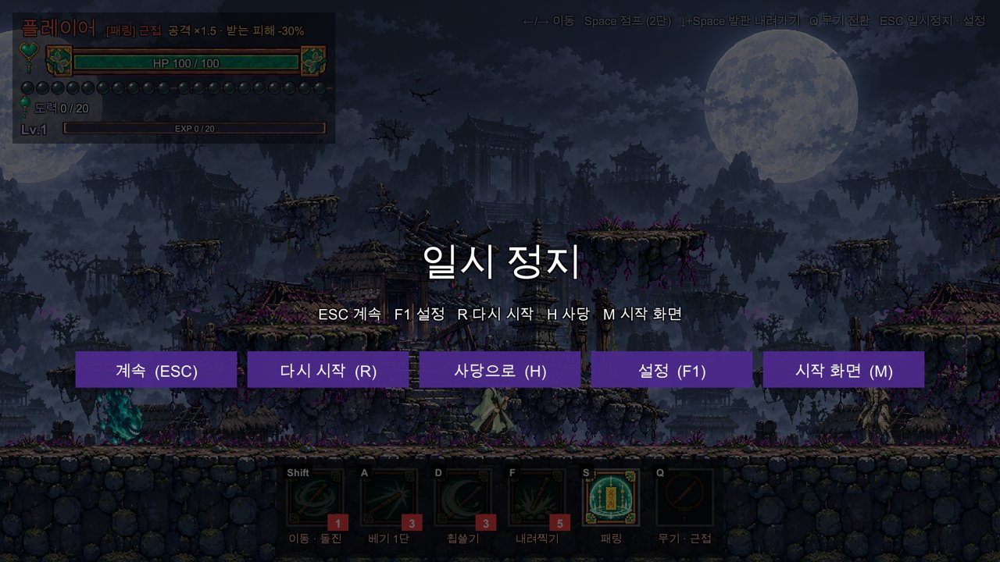
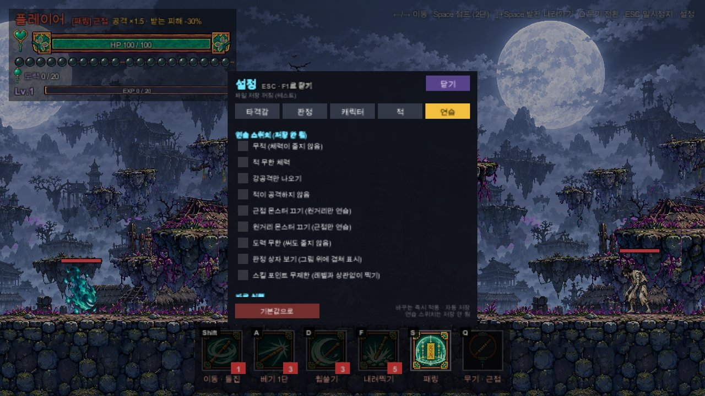

- 설정 창 **연습 탭**에 테스트용 항목을 더했다: **스킬 포인트 무제한**(레벨과 상관없이 찍기, 저장 안 됨) · **스킬 트리 초기화**(익힌 노드 전부 되돌리기, 최대 체력도 원래대로) · **레벨 초기화**(Lv.1로, 스킬 트리도 함께). 스킬 트리 창에는 무제한일 때 "포인트 무제한"으로 표시된다.
- 창 크기는 폭 560 → 680, 내용 높이 420 → 470. 이제 따로 뜨는 창이라 "적을 가리지 않는 높이 상한"은 필요 없어서 테스트도 "화면 안에 들어감"으로 바꿨다.
- 이전의 "플레이하며 슬라이더로 실시간 튜닝"은 창이 게임을 멈추므로 불가능해졌다 — 값은 바꾸는 즉시 적용·저장되니 닫고 확인하는 식이다. 아쉬우면 창을 닫은 채 값만 바꾸는 방식을 따로 논의.

## 21. 스킬 트리: 근접 / 원거리 공격력 트리 분리 (2026-10-17)

공격력 한 줄을 **근접 공격력**과 **원거리 공격력** 두 줄로 나눴다. 이제 스킬 트리는 체력 · 근접 · 원거리 · 자원 4줄(노드 3개씩)이다. 근접 줄(봉, 날 선 봉 → 매서운 손끝 → 필살의 일격)은 봉으로 치는 딜에만, 원거리 줄(부적, 먹 머금은 부적 → 날랜 손놀림 → 천벌의 부적)은 부적으로 쏘는 딜에만 적용되고 서로 영향이 없다. 수치는 각각 +5%×3 → +8%×2 → +15%×1(가안). 줄이 4개가 되어 노드 틀을 조금 줄였다.

## 22. 런 구조 1단계 — 방 흐름과 문 고르기 (2026-10-17)

사당 포탈로 들어가면 **한 판(런)** 이 시작된다(총 6방, 가안). 방을 깨면 **문이 둘** 열리고(왼쪽 끝 / 오른쪽 끝), 문마다 **다음 방 종류가 색과 글자로 표시**돼 있어 하나를 골라 들어간다(스컬 방식). 방 종류는 일반(청백) · 엘리트(귀문 보라) · 보상(금색) · 상점(초록) — 빨강은 적 공격 경고 전용이라 쓰지 않았다. 마지막 방(6번째, 엘리트 관문)을 깨면 사당으로 나가는 문이 열리고 판이 끝난다.

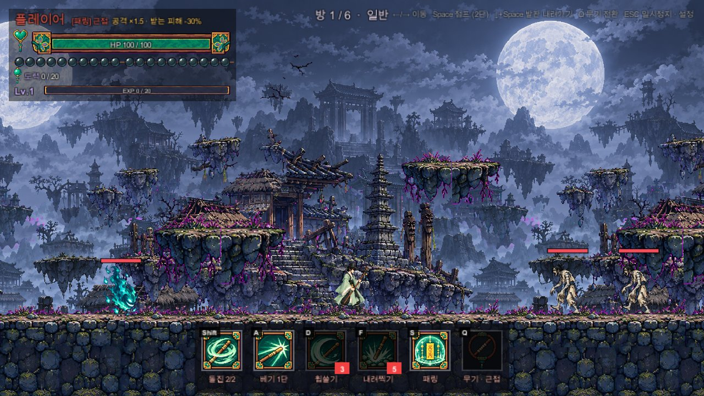
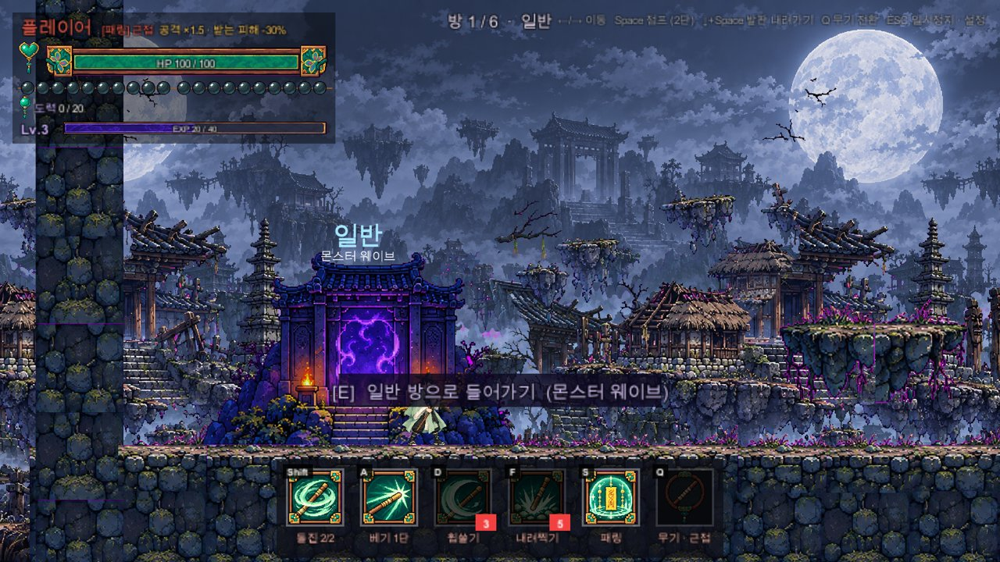
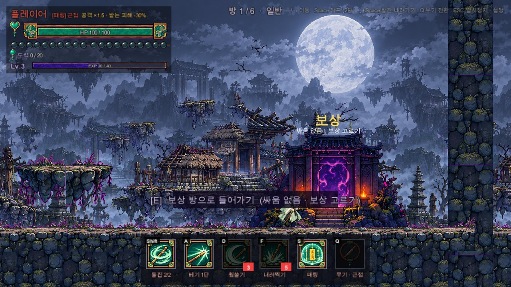

- **일반방**: 몬스터 2파도(방 번호가 커질수록 조금 늘어남) → 다 깨면 문이 열림. **엘리트방**: 체력 3배·경험치 3배 엘리트(보라 빛무리, 판정 크기는 그대로) + 졸개 → 깨면 문. **보상방·상점방**: 이번 단계에선 몬스터 없이 바로 문이 열린다(보상·상점 내용은 2단계).
- 방을 넘어가도 체력·도력·레벨·무기는 이어진다(`PlayerSession`). 사당으로 나가거나 다시 시작(R)하면 판 진행이 사라진다.
- 테스트로 플레이 씬을 바로 열었을 땐(런이 아닐 때) 예전 연습 모드(몬스터 계속 유지) 그대로다.
- 가안 수치: 방 6개, 문 종류 가중치 일반 45 · 엘리트 20 · 보상 20 · 상점 15(두 문은 서로 다른 종류), 파도 구성(`RoomPlan`).

## 23. 런 구조 2단계 — 방 종류별 내용: 엘리트 · 보상 · 상점 (2026-10-17)

방 종류마다 실제 내용을 채웠다. 몬스터를 잡으면 **엽전**(근접 5 · 원거리 7 · 엘리트 25)을 얻고, 엘리트가 주는 **영혼석**(판이 끝나도 남음)과 이번 판 동안 쓰는 **아이템**이 생겼다. 상단 중앙에 방 번호·종류, 엽전, 영혼석, 가진 아이템이 보인다(런 중엔 조작 안내를 숨김).

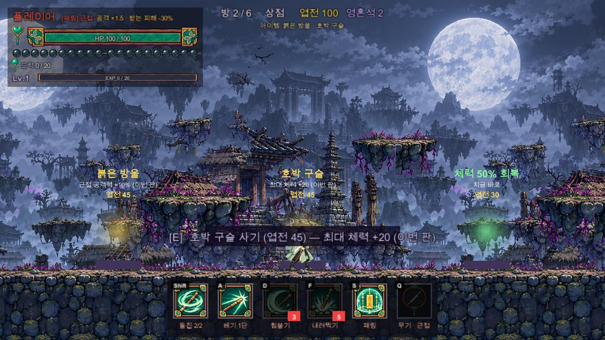
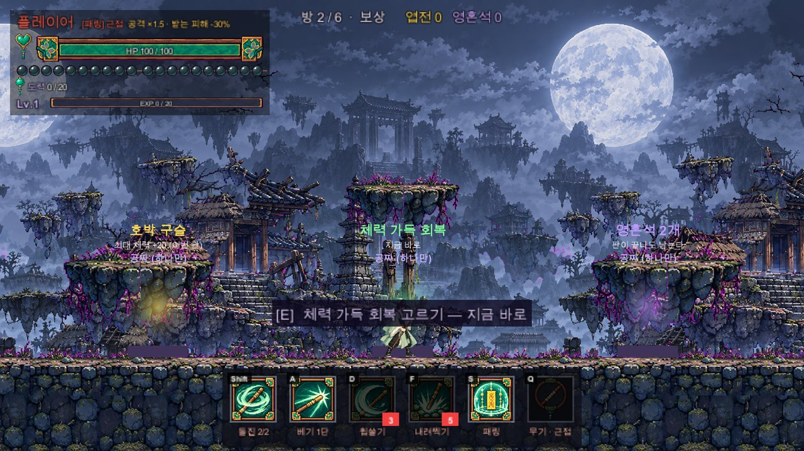
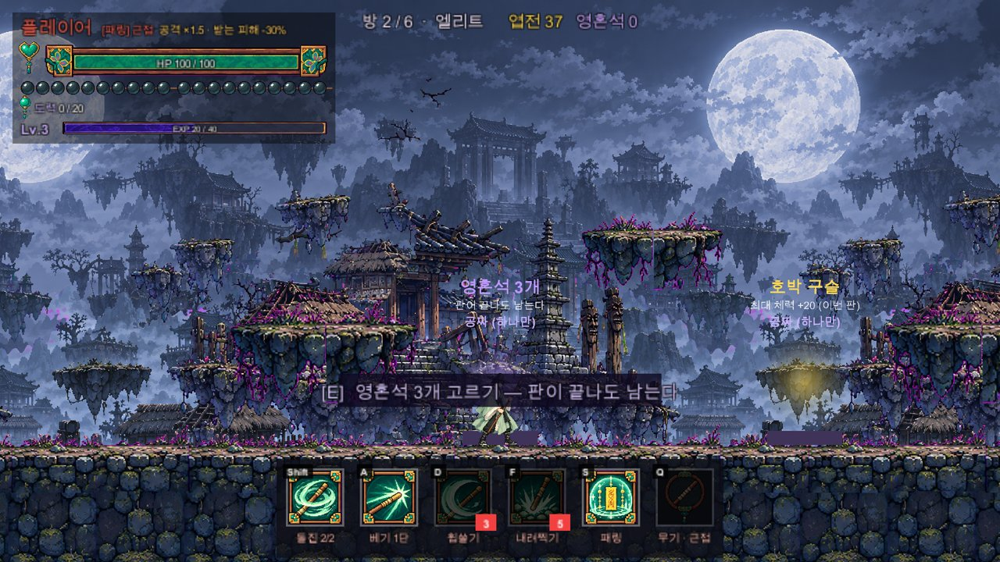

| 방 | 내용 | 문 |
|---|---|---|
| 일반 | 몬스터 2파도 | 깨면 바로 열림 |
| 엘리트 | 엘리트(체력 3배) + 졸개 → **영혼석 3개 또는 아이템 1개** 중 하나(공짜) | 하나를 고르면 열림 |
| 보상 | 싸움 없음. **아이템 · 체력 가득 회복 · 영혼석 2개** 중 하나(공짜) | 하나를 고르면 열림 |
| 상점 | 싸움 없음. **아이템 2개(엽전 45) · 체력 50% 회복(30) · 도력 가득(20)** — 여러 개 살 수 있고 엽전이 모자라면 못 산다 | 바로 열려 있음 |

- 제단(받침 + 빛구슬 + 이름·효과·값 글자)에서 E로 얻는다. 하나만 고르는 방은 고른 뒤 나머지가 잠긴다.
- 아이템(가안, 이번 판 한정): 붉은 방울(근접 공격력 +10%) · 먹 방울(원거리 +10%) · 호박 구슬(최대 체력 +20) · 도력 염주(패링 도력 +1) · 배움 두루마리(경험치 +20%). 스킬 트리와 같은 스탯 합산에 더해진다.
- 영혼석은 얻기만 하고 아직 쓸 곳이 없다 — 스킬 포인트 재화로 쓸지는 결정 필요.

## 24. 런 구조 3단계 — 방마다 다른 맵 구조 (2026-10-17)

좌우로만 달리지 않고 위·아래로도 움직이게, **방마다 발판 배치(지형)를 다르게** 깐다. 같은 플레이 씬에서 `RoomLayout`이 발판 6개를 옮기고 늘리고, 안 쓰는 발판은 판정째 끈다. 바닥 그림은 새 배치대로 다시 깔린다(판정 = 보이는 그림 규칙 그대로).

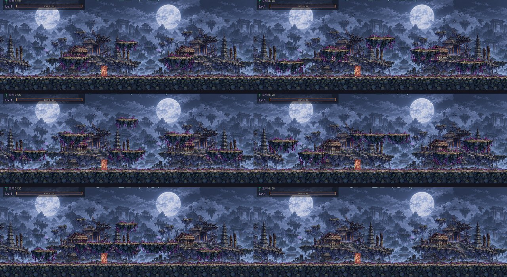

| 지형 | 모양 | 쓰이는 곳 |
|---|---|---|
| 기본 | 낮은 발판 둘 + 가운데 높은 발판 (예전 그대로) | 첫 방 · 연습 모드 |
| 계단산 | 다섯 발판이 산처럼 올라갔다 내려감 (높이 1.8→5.0→1.8) | 싸움방 |
| 지그재그 | 낮은 층 셋 + 엇갈린 높은 층 둘 + 맨 위 하나 (높이 2.4 / 4.6 / 6.6) | 싸움방 |
| 탑 | 가운데 넓은 높은 발판 + 양옆 낮은 발판 + 바깥 중간 발판 | 싸움방 · 마지막 관문 |
| 지붕 | 넓은 중간 발판(폭 14) 위에 작은 발판 하나, 양쪽에 디딤돌 | 싸움방 |
| 평지 | 발판 없음 | 보상·상점 (제단·글자가 가려지지 않게) |

- 싸움방은 바로 앞 방과 같은 지형이 연달아 나오지 않게 한 판의 씨앗(`RunState.Seed`)으로 뽑는다. 방 이름 팝업에 지형 이름이 함께 뜬다.
- 모든 발판은 바닥이나 다른 발판에서 점프(이단 점프 약 3.1)로 올라갈 수 있고, 문 앞 글자(x=±18 근처)를 가리지 않게 테스트로 검증한다. 몬스터는 바닥에서만 움직인다 — 발판은 플레이어의 회피·위치 잡기용(몬스터가 발판을 타는 건 아직 없음).
- 위 사진은 확인용으로 카메라를 넓게 뺀 모습이다(실제 화면은 더 가깝다). 배경에도 떠 있는 섬이 많아 발판과 헷갈릴 수 있다 — 필요하면 발판 색·가장자리를 따로 구분.

## 25. 다음 방 문을 왼쪽에 나란히 (2026-10-17)

방을 깬 뒤 열리는 문 두 개를 **둘 다 왼쪽 끝에 나란히** 세웠다(예전: 왼쪽 끝 하나 · 오른쪽 끝 하나). 바깥 문(x≈-20)과 안쪽 문(x≈-16) 사이 4.2유닛으로 글자가 겹치지 않는다. 문이 하나뿐일 땐 두 자리 사이에 선다. 문 글자를 발판이 가리지 않도록 왼쪽 발판 끝은 x=-14.2 안쪽으로 제한하고(지그재그·탑 지형의 바깥 발판을 안쪽으로 옮김), 사당 출구(마지막 방)는 그대로 가운데 쪽이다.

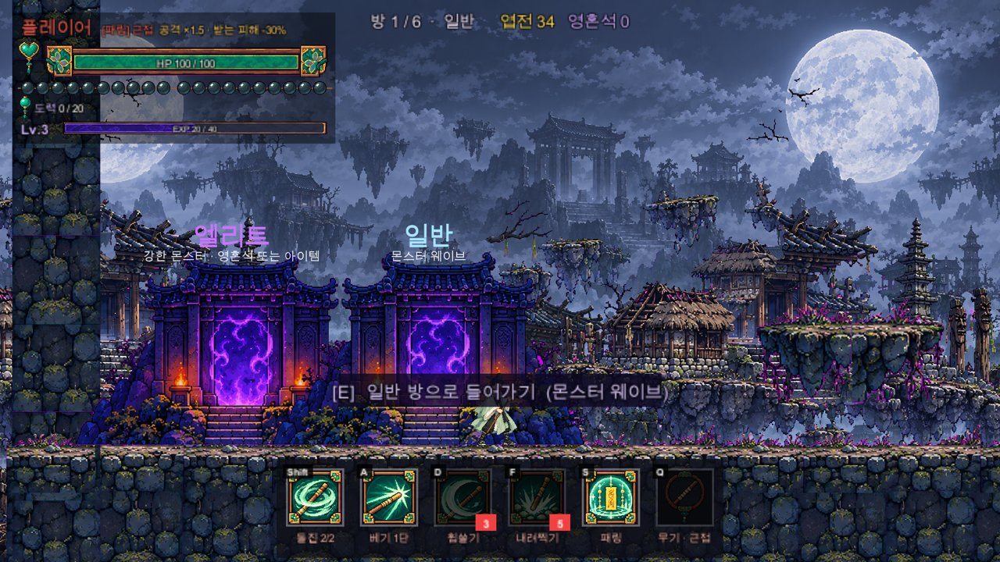

## 26. 문을 오른쪽으로 · 방은 왼쪽 끝에서 시작 · 문에 일렁이는 소용돌이 (2026-10-17)

- **문 위치**: 다음 방 문 둘을 **오른쪽 끝에 나란히**(바깥 x≈20 · 안쪽 x≈16) 세웠다. 방에 들어오면 플레이어는 **가장 왼쪽(바닥 끝에서 2유닛 안)** 에서 시작하고 카메라도 바로 따라가서, 왼쪽에서 오른쪽으로 싸우며 나아가 문을 고르는 흐름이 된다(연습 모드는 예전 시작 위치). 몬스터는 플레이어 오른쪽에서 나온다. 발판은 문 글자를 가리지 않도록 오른쪽 끝이 x=14.2 안쪽이다(좌우 대칭이라 왼쪽도 같다).
- **일렁이는 효과**: 사당 포탈에 쓰던 연출(문 안쪽 **소용돌이 16장 반복** + 문 뒤 빛무리 + 안쪽 빛, 가까이 갈수록 밝아지고 들어갈 수 있는 거리에선 더 환하게 숨 쉼)을 `DoorEffects`로 떼어 내 방 문에도 붙였다. 빛과 소용돌이에 **방 종류 색**(엘리트 보라 · 보상 금색 · 상점 초록 · 일반 청백)을 섞어 어느 문인지 한눈에 보인다. 사당 포탈도 같은 컴포넌트를 쓴다(모양은 그대로).

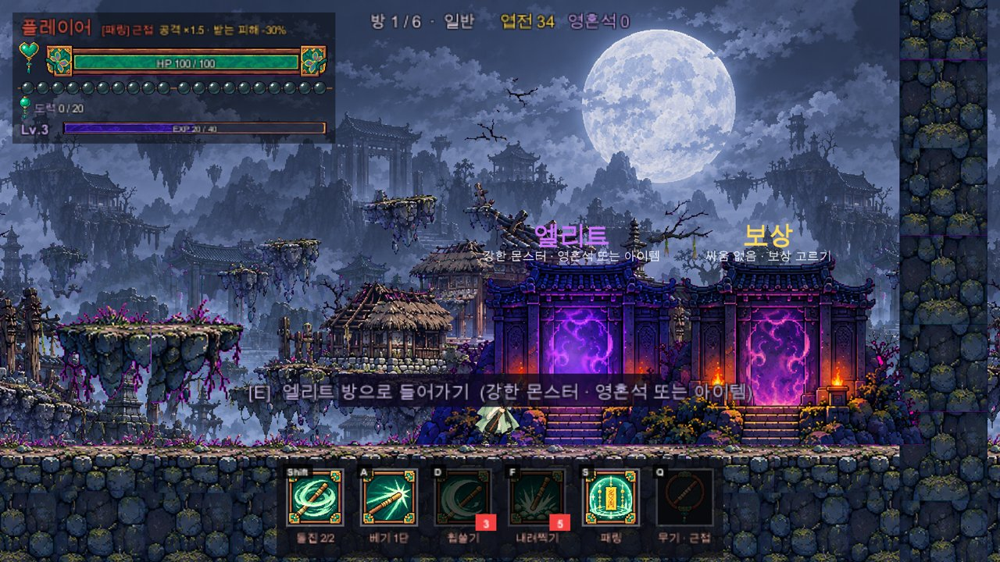

## 27. 근접 일반공격(A) 연속 입력을 부드럽게 (2026-10-17)

화면 모양은 그대로이고 **조작 느낌**만 바꿨다(그래서 스크린샷은 없다). **문제**: 쿨타임(1·2단 0.35초 / 마무리 0.6초)이 끝나기 직전에 A를 누르면 입력이 버려져서, 박자를 살짝만 일찍 눌러도 한 번 건너뛰어 연속 공격이 뚝뚝 끊겼다. **수정**: 쿨타임이 **거의 끝났을 때(남은 시간 0.22초 이하)** 누른 A는 기억해 뒀다가 쿨타임이 끝나는 순간 바로 나간다(입력 버퍼). 한참 일찍(막 친 직후) 누른 건 예전처럼 무시해서 연타가 쌓여 저절로 나가지는 않는다. 패링을 막 켠 동안·도력이 모자랄 때는 버퍼가 있어도 막힌다. 버퍼 길이는 `PlayerCombat.attackBuffer`(인스펙터) — 더 길게 하면 더 관대하고, 0이면 예전과 같다. 원거리 화살에도 같은 버퍼가 적용된다.

- 테스트(`SkillTests`): 쿨타임 막바지 입력은 끝나는 순간 나가고 일찍 누른 입력은 무시 / 0.3초마다 눌러도 끊기지 않고 이어짐. 실제 손맛(0.22초가 알맞은지)은 직접 플레이로 확인 필요.

## 28. 바닥 구멍(추락 → 피해 + 복귀)과 피격 직후 무적 (2026-10-17)

**바닥 구멍**: 일부 방(지그재그 · 탑 · 지붕)은 바닥이 군데군데 뚫려 있다(폭 3~3.4유닛, 점프 한 번으로 건널 수 있다). 빠지면 **추락 피해 15**(방어 패시브·무적 무시)를 입고, **떨어지기 전에 서 있던 자리(구멍 가장자리에서 1.2유닛 이상 안쪽)** 로 돌아오며 1.5초 동안 무적이다. 첫 방(기본)과 보상·상점(평지)에는 구멍이 없고, 시작 자리(왼쪽 끝)와 문 앞(오른쪽 끝)에서 12유닛 안쪽에만 있다.

- 몬스터는 바닥을 걷는 AI라 구멍에 빠지면 안 되므로, 구멍 위에 **보이지 않는 다리**를 깔았다(몬스터는 그 위를 지나고 플레이어는 충돌을 무시해 빠진다). 그래서 몬스터가 구멍 위 허공을 걸어 건너는 모습이 보일 수 있다 — 거슬리면 몬스터가 구멍 앞에서 멈추게 바꿀 수 있다.
- **피격 직후 무적**: 맞으면 **1초 동안 또 맞지 않고**(적 공격은 몸을 통과, 베기는 한 번만 판정) 몸이 깜빡인다. 패링은 무적 중에도 된다. 연타 피해를 없애려는 것이라 무적 시간은 `PlayerParty.hurtInvulnerableTime`(인스펙터)로 조절한다. 추락 피해는 무적도 무시한다.
- 가안 수치: 추락 피해 15 · 피격 무적 1.0초 · 복귀 무적 1.5초. 구멍 배치는 `RoomLayout.Pits`.

## 29. 경험치는 방을 깼을 때만 (런 중) (2026-10-17)

스킬 포인트는 계속 레벨업으로 얻는데, 몬스터를 잡을 때마다 경험치(10~15)를 주니 한 방(7~8마리)에 레벨이 여러 번 올라 포인트가 너무 많았다. 이제 **한 판(런) 중에는 몬스터 처치 경험치가 없고, 방을 깼을 때 한 번에** 준다: 일반 20 · 엘리트 35 · 마지막 관문 50 · 보상·상점 0(가안, 스킬 트리 "배움의 기운"·아이템 "배움 두루마리"의 경험치 배율은 그대로 적용). 한 판에 약 140 → Lv.1에서 Lv.4~5 정도. 방을 깨면 플레이어 머리 위에 "방 클리어 +20 EXP"가 뜬다. 연습 모드(사당을 거치지 않고 플레이 씬을 연 경우)는 예전처럼 몬스터마다 준다.

## 30. 평타 약화 — 데미지 감소 · 경직 구분 (2026-10-17)

**문제**: 평타(A)를 맞힐 때마다 몬스터가 밀리고 경직되며 **하던 공격(예비 모션)이 끊겨서**, 평타만 계속 치면 패링할 이유가 없었다. **수정**: 맞은 몬스터가 움찔하는 정도를 세 단계로 나눴다(`HitStagger`).

| 공격 | 데미지 (전 → 후) | 경직 |
|---|---|---|
| 봉 1단 | 15 → **10** | **없음** (피해만, 밀리지도 공격이 끊기지도 않는다) |
| 봉 2단 | 18 → **12** | **없음** |
| 봉 3단(마무리) | 28 → **20** | 있음 — 밀림 + 경직 + 기절 0.35초 (공격이 끊긴다) |
| 부적 평타 | 12 → **7**, 쿨타임 0.45 → **0.3초** (더 빠르게 연사) | **약함** — 살짝(30%) 밀리기만 하고 공격은 끊기지 않는다 |
| 반격 · D/F 스킬 | 그대로 | 그대로 (경직 있음) |

- 평타 초당 딜: 봉 약 47 → 32, 부적 약 27 → 23. 몬스터의 공격을 끊는 건 이제 **패링 반격·스킬·봉 3단 마무리**만 한다.
- 화면 모양 변화가 아니라 스크린샷은 없다. 수치는 가안 — 직접 플레이해 보고 조정.

## 31. 구멍 앞에서 멈추는 창귀 · 건너오는 도깨비불 · 구멍 벽 판정 (2026-10-17)

- **증상 1**: 몬스터가 바닥 구멍 위 허공을 걸어서 건넜다. **원인**: 몬스터는 중력을 받지 않는(키네마틱) 몸이라 위치만 옮기며 걸어서, 발밑에 땅이 없어도 그대로 지나갔다(전에 깐 "보이지 않는 다리"는 사실 필요 없었다 → 삭제). **수정**: 걷는 몬스터(창귀)는 움직이기 전에 **앞발 아래에 땅이 있는지** 검사해서 없으면 멈춘다 — 구멍 가장자리에서 서서 기다린다. 맞고 밀릴 때도 구멍 쪽으로는 밀리지 않고, 생길 때 구멍 위면 가까운 땅으로 옮겨서 생긴다. **도깨비불(원거리)은 떠다니므로** 구멍 위를 그대로 건너온다.
- **증상 2**: 구멍에 떨어질 때 몸이 구멍 옆 땅(벽처럼 보이는 속 채움 그림)을 뚫고 지나갔다. **원인**: 바닥 판정이 윗면 1유닛 두께뿐이고 그 아래는 그림만 있었다. **수정**: 바닥 판정을 속 채움 그림만큼 **깊게(5유닛)** 만들었다 — 윗면은 y=0 그대로라 서 있는 높이는 같고, 구멍 옆은 아래까지 단단한 벽이 된다(보이는 땅 = 판정).
- 혹시 바닥 밖으로 밀려난 몬스터가 생기면 방이 안 끝나는 일이 없게 치운다.

## 32. 근접 평타·패링 반격의 앞으로 내딛기 제거 (2026-10-17)

봉 평타(1~3단)와 근접 패링 반격 때 몸이 앞으로 0.45유닛 내딛던 동작(`PlayerMotor.Lunge`)을 없앴다 — 이제 **제자리에서** 벤다/반격한다. 판정 박스·데미지·이펙트는 그대로. D 휩쓸기·부적 부채꼴 스킬의 내딛기는 남겨 두었다(요청 범위 밖). 화면 모양 변화가 아니라 스크린샷은 없다.

## 33. D/F 스킬 쿨타임을 봉·부적 따로 (2026-10-18)

예전엔 D·F 스킬 쿨타임을 무기끼리 공유해서, 봉 D(휩쓸기)를 쓰고 부적으로 바꾸면 부적 D(부채꼴)도 쿨타임이었다. 이제 **봉 D·F와 부적 D·F가 쿨타임을 따로 센다** — 봉 스킬을 쓰고 Q로 바꿔 바로 부적 스킬을 쓸 수 있다. 들고 있지 않은 무기의 쿨타임도 계속 흐르고, 스킬바는 지금 든 무기의 쿨타임을 보여 준다. 도력 소모(D 3 · F 5)는 그대로라 연속으로 쓰면 도력이 그만큼 든다. 화면 모양 변화가 아니라 스크린샷은 없다.

## 34. 보스 불가살이 — 마지막 방, 상단 체력바, 50%에서 변신하는 2페이즈 (2026-10-18)

한 판의 **마지막 방(6번째)이 보스방**이 됐다. 문에는 "보스 · 불가살이 · 마지막 관문"(용암빛 주황)이 뜨고, 지형은 **평지로 고정**이다. 보스방은 큰 보스가 화면에 다 들어오게 **카메라를 넓게(6 → 7.2) 빼고** 배경도 그만큼 키웠다(바닥 높이는 같음). 그림은 에셋 `원본/boss/bulgasari`(가공본 `미리보기/bulgasari_*_strip.png`, 칸 1024×640, 1·2페이즈 시트)를 그대로 잘라 썼다.

- **체력 UI**: 머리 위 체력바 대신 **화면 위쪽에 용 장식 틀(에셋 `dragon_frame`)의 보스 체력바**가 뜨고 "불가살이 73%"처럼 **퍼센트**로 표시한다. 줄어드는 모습이 보이게 살짝 따라가고, 2페이즈에서는 채움 색이 더 붉게 타오르며 "2페이즈" 글자가 붙는다(빨강은 적 공격 경고 전용이라 주황 계열).
- **1페이즈**: 체력 900(가안), 근접 공격 — 3연타 모션(일반) · 강공격(준비 → 내려치기). 창귀와 같은 노랑 → 빨강 느낌표로 패링 타이밍을 알려 준다. **슈퍼 아머**라 보통 경직(반격·스킬·봉 3단)에도 공격이 끊기지 않고, **강공격을 패링한 반격에만** 끊긴다. 기절 시간은 60% 줄어든다. 크고 무거워 밀리지 않는다.
- **변신(체력 50% 아래)**: 하던 공격을 멈추고 **무적 + 제자리**에서 변신 동작(6장) 재생 · 화면 주황 플래시 · 흔들림 · 고리 파동 · "불가살이가 깨어난다 — 2페이즈". 중간에 몸이 커진다(판정도 함께 3.6×3.0 → 5.0×4.0, 발은 땅에). 1페이즈에서는 체력이 1 아래로 내려가지 않아 한 방에 2페이즈를 건너뛰고 죽지 않는다.
- **2페이즈**: 2페이즈 그림(타오르는 모습 · 코 휘두르기 · 강공격), **공격 박자 25% 빠름**(예비 모션·회복·공격 간격 × 0.75 → 일반 반응시간 1.0 → 0.75초), 강공격 확률 35% → 45%, 베기가 더 길고 높다.
- 쓰러뜨리면 보스 체력바가 사라지고 사당으로 나가는 문이 열린다. 수치(체력·데미지·박자)는 전부 가안 — 직접 싸워 보고 조정.

### 34-1. 보스 3연타 · 보스방 전용 배경 (2026-10-18)

불가살이 전용 특수 패턴 에셋(이펙트)은 아직 없다(에셋 안내: "P9 적·보스 이펙트는 다음 묶음"). 그래서 지금 있는 에셋으로 할 수 있는 두 가지를 넣었다.

- **1페이즈 3연타**: "3연타" 모션(6장: 웅크림 · 들어올림 · 첫 할퀴기 · 둘째 · 크게 내지르는 셋째 · 회복)을 한 번 베는 일반 공격으로만 쓰던 것을 **실제로 세 번 베는 연속 공격**으로 바꿨다. 타격 사이 간격 0.6초, **타격마다 느낌표가 새로 노랑 → 빨강**으로 타이밍을 알려 줘서 연속 패링 패턴이 된다. 한 번당 데미지는 10(세 번 다 맞으면 30). 2페이즈 일반 공격(코 휘두르기)은 한 번이고 대신 더 빠르고 세다(16).
- **보스방 배경**: 에셋의 불가살이 보스방 배경(쇠사슬 감긴 거대한 문 + 깃발 기둥, `미리보기/bg/boss`의 먼·중간 2겹)을 보스방에서만 깐다. 구간 순환(설정 창 "배경 구간 바꾸기")에는 들어가지 않는다. (안내에 "문 겹침" 문제로 보류됐던 배경 — 넓은 화면에서 문이 좌우로 반복돼 보일 수 있다.)

### 34-2. 불가살이 특수 패턴 — 가시 발사 · 땅 찍기 · 돌진 (2026-10-18)

사용자가 준 이펙트 묶음 **bulgasari-vfx**의 그림 시트 3장(`Textures/` — 돌진 속도선 · 날아가는 가시 · 바닥 원형 충격파, 96×96 × 8장, 투명 PNG)을 잘라(`Tools/gwimun_sprites/cut_bossfx.py` → `Assets/Art/Fx/bossfx_*`) 불가살이의 **특수 패턴 3종**에 붙였다. (묶음의 선으로 그리는 코드 이펙트는 처음에 써 봤다가, 사용자 요청으로 그림 시트로 바꾸고 코드는 쓰지 않는다.) 이펙트는 보이기만 하고, 맞는 판정은 다른 적 공격처럼 `EnemyAttack` 상자로 따로 만든다(패링 가능).

| 패턴 | 언제 | 내용 | 대처 |
|---|---|---|---|
| **가시 발사** | 거리가 멀 때 (1·2페이즈) | 입 앞에서 플레이어 쪽으로 **가시 5개**를 부채꼴(9° 간격)로 쏜다 — 가시 그림이 날아가는 방향으로 돌아간다. 속도 11 고정, 하나당 8 | 하나하나 패링하거나 피한다 |
| **땅 찍기** | 가까울 때 (1·2페이즈) | 앞발로 내리치면 바닥에 **원형 충격파·균열**이 퍼지고, 바닥을 타고 앞뒤로 충격파(높이 1)가 나간다. 플레이어 쪽은 강공격(패링 시 도력 +3), 14 | 점프로 넘거나 패링 |
| **돌진** | 2페이즈, 거리가 멀 때 | 몸통 앞 박치기 판정(속도선 그림)과 함께 플레이어 쪽으로 달리고, 지나간 자리에 잔상이 남는다(속도 14, 최대 16). 강공격 22 | **패링하면 그 자리에서 멈춘다**, 대시로 통과도 가능 |

- 패턴마다 **예비 동작(강공격 준비 모습) 1.0초 + 노란 느낌표 → 나가기 직전 빨강**으로 알려 주고, 끝나면 0.7초 쉰다(반격할 틈). 2페이즈는 이 시간들과 패턴 간격이 Tempo(0.75)만큼 짧아진다.
- 일반 공격 사이에 섞인다: 첫 패턴은 방에 들어오고 5초 뒤, 그 뒤로 7~10초마다. 변신이 시작되면 하던 패턴은 멈춘다. 수치는 전부 가안.

### 34-3. 2페이즈 중 잠깐씩 1페이즈 모습으로 돌아가던 문제 (2026-10-18)

**증상**: 2페이즈에서 맞거나(강공격 반격) 기절하면(D·F 스킬) 그 순간 작은 1페이즈 모습이 잠깐 보였다. **원인**: 에셋의 피격 시트(`hurt`, 4장 = 1페이즈 2장 + 2페이즈 2장)는 2페이즈 장면까지 **전부 1페이즈 크기로 그려져 있다**(에셋 안내 7절 "알려진 문제"). 2페이즈 경직·기절 그림으로 그 뒤 2장을 썼더니, 몸 그림이 갑자기 작아져 1페이즈로 돌아간 것처럼 보였다. **수정**: 2페이즈 경직·기절 그림은 **2페이즈 대기 그림**을 쓴다(맞을 때의 하얀 번쩍임·기절의 파란 색은 그대로라 맞은 티는 난다). 1페이즈는 그대로 피격 시트. 테스트: 2페이즈에서 강공격 반격·기절 중 화면 그림이 1페이즈/피격 시트로 바뀌지 않는지 확인. (화면에 남는 모습은 2페이즈 그대로라 스크린샷은 생략.)

### 34-4. 보스는 경직에 걸리지 않는다 (2026-10-18)

예전엔 강공격을 패링한 반격에는 보스도 경직(하던 공격이 끊김)이 걸렸는데, 이제 **어떤 공격에도 경직이 걸리지 않는다**(사용자 요청). 반격·스킬·봉 3단·강공격 반격 모두 피해만 들어가고, 예비 모션 중에 맞아도 공격은 그대로 나간다. 원래 넉백이 0이라 밀리지도 않는다. **기절**(D 휩쓸기·F 내려찍기·봉 3단·봉인진)은 따로라 지금처럼 60% 짧게 걸린다. 돌진은 박치기 판정을 패링하면 여전히 그 자리에서 멈춘다. 화면 변화가 아니라 스크린샷은 없다.

### 34-5. 보스 공격을 연속 5번 패링하면 기절 (2026-10-18)

보스는 경직이 안 걸리는 대신, **보스 공격을 맞지 않고 연속 5번 패링하면 2.5초 기절**한다(기절 저항 무시 — 평소 스킬 기절은 60% 짧게 걸림). 일반 공격 · 3연타의 한 타 · 강공격 · 가시 하나 · 충격파 · 돌진 모두 한 번으로 센다. **플레이어가 맞으면(추락 포함) 처음부터**, 기절하면 다시 0부터. 보스 체력바에 "연속 패링 3 / 5"로 보이고, 기절하는 순간 "불가살이 기절! (5연속 패링)" + 머리 위 "기절!" + 파란 플래시·고리 파동. 변신 중엔 세지 않는다. 기절하면 하던 특수 패턴도 끊긴다. (보스 체력바가 떠 있으면 화면 가운데 팝업 글자를 체력바 아래로 내려 가리지 않게 했다.)

## 35. 보스 이펙트 수정 및 공격 범위 가시성 제거 (2026-10-19)

### 35-1. 불가살이 이펙트를 보스 디자인에 맞춰 새로 그림

**문제**: bulgasari-vfx 시트는 위에서 내려다본 원형 충격파·단순한 삼각 속도선이라 옆 시점 게임·보스 그림(쇠 가시 · 녹슨 철판 · 2페이즈 용암 균열)과 어울리지 않았다. 또 땅 찍기에서 바닥을 타고 가는 충격파 판정 2개에는 그림이 없어 **주황 네모**가 그대로 굴러갔다.
**수정**: `Tools/gwimun_sprites/make_bossfx.py`가 보스 그림의 색으로 이펙트를 코드로 그린다(90px = 1유닛, 땅 이펙트는 바닥선 기준 옆모습). 쇠 가시(반복) · **바닥을 뚫고 솟는 가시 파도**(충격파 판정에 붙음, 새로) · 찍은 자리 섬광 → 반원 충격파 · 양옆 용암 균열 · 바위·가시 파편 · 흙먼지 · 돌진 앞 압력파 · **돌진 잔상**(새로). 2페이즈에선 몸 크기만큼 커진다. 패턴마다 나오던 코드 주황 원은 뺐다. 원래 시트·`cut_bossfx.py`는 쓰지 않는다.

| 전 | 후 |
|---|---|
|  |  |
|  |  |

### 35-2. 몬스터 공격 범위 네모 숨김

**문제**: 창귀 베기·불가살이 일반 공격/3연타는 베는 이펙트 그림이 없어서 판정 네모가 반투명 빨강·주황으로 그려져 공격 범위가 보였다.
**수정**: 적 공격의 판정 네모는 그림이 있든 없든 **설정의 "판정 상자 보기"를 켰을 때만** 보인다. 베기 끝의 작은 번쩍임 네모도 뺐다. 판정·느낌표·몸 공격 동작·패링 불꽃은 그대로. 테스트: 창귀 베기 네모가 평소 숨고 "판정 상자 보기"에서만 보이는지.

| 전 | 후 |
|---|---|
|  |  |
|  |  |
